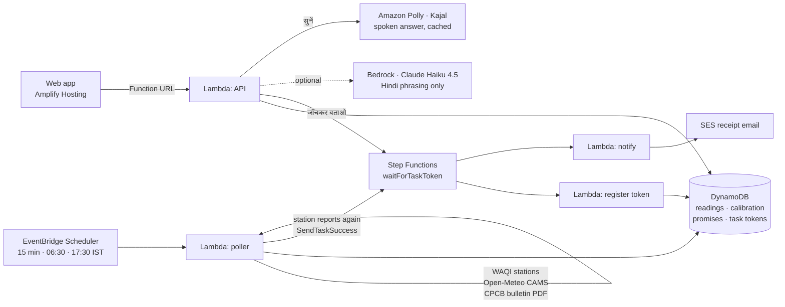

<div align="center">

# ताज़ा हवा · Taaza Hawa

### अभी बाहर जाऊँ? — *Can I go outside right now?*

**Delhi's air-quality number, with its age. An honest range when it's old. A public grade when the truth arrives.**

`Air track` · WeMakeDevs × AWS Environmental Hacks 2026 · Serverless on AWS ·  [AWS Amplify deployed link](https://main.d2r1frd99buxhf.amplifyapp.com/)

</div>

---

## The problem

Every October morning a Delhi resident checks one number before a run, a walk, or sending a child to practice. That number has **no age, no source and no error bar**.

It is often old. On 4 Oct 2026 the mirror most people use showed Anand Vihar **31 hours** stale and NSIT Dwarka **56 hours** stale ([R2](docs/wayfinder/research/R2-data-feeds-audit.md)). CPCB's own bulletin shows 2–3 of 46 Delhi stations not reporting on an ordinary day ([R1](docs/wayfinder/research/R1-delhi-ground-truth-oct-2026.md)). Last season's loudest complaint on r/delhi was not *"what is the AQI"* but *"can I trust it"* ([R7](docs/wayfinder/research/R7-citizen-friction-mining.md)).

Nobody shows people **how old** the number is, gives them an honest estimate when it's stale, and then **checks that estimate in public**.

## What Taaza Hawa does

| | |
|---|---|
| **1. One answer** | **जाओ** (Go) · **10 बजे के बाद** (Wait till 10) · **अंदर रहो** (Stay in), from a fixed, published rule on the CPCB AQI bands. |
| **2. The Taaza badge** | Every number shows its **age** and **source**, always. |
| **3. A range when it's stale** | If the nearest reading is over 3 h old, the app shows *"act as if 232–264"*, a split-conformal interval built from the 3 nearest live stations plus bias-corrected CAMS. The decision uses the top of the range. |
| **4. जाँचकर बताओ (Check it and tell me)** | One tap records the promise. An **AWS Step Functions** execution waits, at no compute cost, until the station reports again. |
| **5. The grade** | The station's own next reading decides: **सही (Hit)** or **चूक by N (Missed)**. No model judges itself. |
| **6. The Scoreboard** | Every Delhi station, every morning: Hit / Missed / Pending, misses shown as loudly as hits. |

> **Honesty line.** We say: reading age, the named source, the range and its inputs, Hit / Missed, and CPCB's own participation count, quoted. We never say a station is "dark" or "tampered", never claim a "true AQI", never assign blame, and never make health-outcome claims. *Station air, not your street. An estimate, not the truth.*

## Architecture



| Service | Why this one |
|---|---|
| **EventBridge Scheduler** | 15-minute polling plus the 06:30 and 17:30 IST jobs, with no server |
| **Lambda** (5 functions) | Poller, API, and three steps of the receipt. Pure functions, unit-tested |
| **DynamoDB** | One pay-per-request table: readings, calibration, promises, task tokens |
| **Step Functions Standard** | A promise *is* a waiting execution. It can wait up to 72 h for free, and you can watch it flip from Running to Succeeded |
| **Lambda Function URL** | A public API without API Gateway |
| **Polly** | The "सुनें" button reads the answer aloud in Hindi or English (neural voice Kajal, available in Mumbai). The server builds the text itself, so the endpoint cannot be used to read arbitrary text, and each wording is synthesized only once |
| **SES** | Optional Hit / Missed receipt by email |
| **Amplify Hosting** | Static Vite build, rebuilt on every push |
| **CloudWatch** | Alarm when the poller keeps failing |
| **Bedrock** *(optional)* | Rephrases one Hindi sentence. A guard rejects any change to a number; it never decides anything |

## How the estimate stays honest

- **Calibrated on live data.** On every poll, each fresh station is *re-estimated with its own reading hidden*, from its neighbours and CAMS. The error goes into that station's residual list. Ranges use split-conformal quantiles at 80% coverage.
- **Says when it isn't ready.** Until a station has 20 residuals, its range is labelled *calibration warming up* and widens with the reading's age.
- **Grades only on later readings.** A reading backfilled with an older timestamp never grades a promise.
- **Hit or Missed by N**, plus *Missed, still waiting* after 72 h of silence.

## Repository layout

```
backend/
  src/taaza/       core logic: AQI maths, freshness, conformal, estimator, grader, store, Hindi copy
  src/taaza/sources/  WAQI, Open-Meteo CAMS, CPCB bulletin
  src/handlers/    Lambda entry points: poller, api, hold_tasks
  tests/           18 unit tests, including the stale → hold → graded loop
  local_server.py  same API locally: demo data, or --live feeds
infra/
  template.yaml    SAM: table, Lambdas, schedules, state machine, Function URL, alarm
  hold.asl.json    the waitForTaskToken receipt
web/               Vite PWA: Hindi/English, light/dark, desktop and mobile
amplify.yml        Amplify build for web/
docs/              research, council verdicts and the full spec
```

## Run it locally

Needs Python 3.12 and Node 20+.

```bash
# backend tests
cd backend && python -m pytest -q

# API with SYNTHETIC demo data (every response says "demo": true; the UI shows a banner)
python backend/local_server.py            # http://localhost:8787

# or with live feeds (free token: aqicn.org/data-platform/token)
WAQI_TOKEN=... python backend/local_server.py --live

# web app
cd web && npm install && npm run dev      # http://localhost:5173
```

Demo mode only: `POST /dev/return?uid=1` makes a stale station report again, so you can rehearse a Hit.

## Deploy to AWS

```bash
sam build -t infra/template.yaml
sam deploy --guided --region ap-south-1   # asks for WaqiToken (hidden); later: just `sam deploy`
```

Then connect this repo in **Amplify Hosting**. It reads `amplify.yml`. Set `VITE_API_URL` to the stack's `ApiUrl` output.

| Parameter | Purpose |
|---|---|
| `WaqiToken` | WAQI API token (NoEcho) |
| `DefaultStationUid` | Station shown to first-time visitors |
| `SesSender` | Verified SES address; empty turns emails off |
| `BedrockModelId` | e.g. `in.anthropic.claude-haiku-4-5-20251001-v1:0`; empty uses the template sentence |

Cost at hackathon scale is within the AWS Free Tier. Bedrock, if enabled, is the only per-call cost.

## Status

Built during the hack window (8–11 Oct 2026). Open work is tracked as [issues](https://github.com/Cubix33/taaza-hawa/issues):

- [x] Core engine, grader and calibration, with tests
- [x] Lambda handlers, SAM stack, receipt state machine
- [x] Web app: Hindi/English, light/dark, desktop and mobile
- [x] Backend deployed to AWS
- [ ] Live WAQI scale check (K3) and real Dwarka default station
- [ ] CPCB bulletin parser checked on a real PDF
- [ ] End-to-end "check it and tell me" loop recorded on AWS
- [ ] Demo film and AWS Builder Center blog

## Research behind it

The idea was chosen through written research and a multi-perspective review before the clock started:

- [Full spec](docs/wayfinder/IDEA-taaza-hawa.md)
- [Council verdict](docs/wayfinder/council/03-verdict.md)
- [Research R1–R8](docs/wayfinder/research/)
- [Decision map](docs/wayfinder/MAP.md)

**Data:** WAQI (aqicn.org) mirror of CPCB stations · Open-Meteo CAMS · CPCB daily AQI bulletin. Values are station air, not your street.
