<div align="center">

# ताज़ा हवा · Taaza Hawa

### अभी बाहर जाऊँ? &nbsp;·&nbsp; *Can I go outside right now?*

**Delhi's air-quality number, with its age.<br/>An honest range when it's old. A public grade when the truth arrives.<br/>And a 06:30 plan for every school: assembly, PE, recess.**

<br/>

[](https://main.d2r1frd99buxhf.amplifyapp.com/)
&nbsp;
[](https://builder.aws.com/content/3JUMvwGOd6xSXZP8H7s6sZiFFTK/the-number-has-an-age)
&nbsp;


WeMakeDevs × AWS **Environmental Hacks 2026**

<br/>

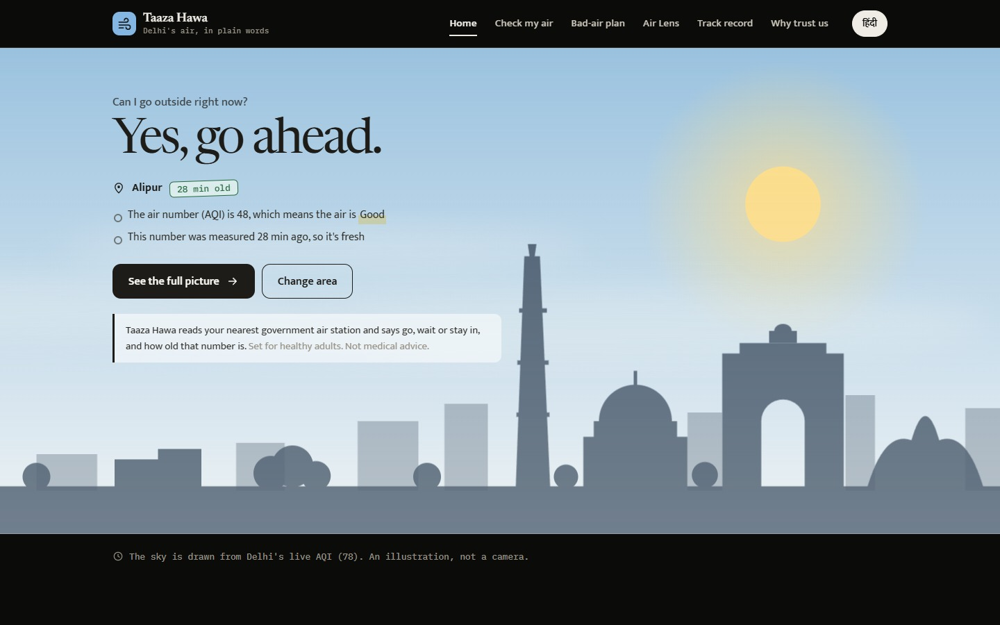

<sub>The sky, the haze and the sun are an illustrative artwork parameterized by Delhi's live AQI: clear air looks clear, smog looks like smog.</sub>

<br/>

### 🎬 Demo video

[](https://www.youtube.com/watch?v=OW2FaWJGFAA)

<sub><a href="https://www.youtube.com/watch?v=OW2FaWJGFAA">Watch on YouTube</a></sub>

</div>

---

## Contents

[The problem](#the-problem) · [What it does](#what-it-does) · [Results at a glance](#results-at-a-glance-stale-reading-backtest) · [For schools](#for-schools) · [A tour](#a-tour) · [How the loop works](#how-the-loop-works) · [Architecture](#architecture) · [AWS console proof](#aws-console-proof--observability) · [Where AI is used](#where-ai-is-used) · [Honest by design](#honest-by-design) · [Run it](#run-it-locally) · [Deploy](#deploy-to-aws) · [API](#api) · [Repo layout](#repository-layout) · [Status](#status) · [Research](#research-behind-it)

---

## The problem

Every October morning a Delhi resident checks one number before a run, a walk or a ride. That number has **no age, no source and no error bar**.

It is often old. On 4 Oct 2026 the mirror most people use showed Anand Vihar **31 hours** stale and NSIT Dwarka **56 hours** stale ([R2](docs/wayfinder/research/R2-data-feeds-audit.md)). CPCB's own bulletin shows 2–3 of 46 Delhi stations not reporting on an ordinary day ([R1](docs/wayfinder/research/R1-delhi-ground-truth-oct-2026.md)). Last season's loudest complaint on r/delhi was not *"what is the AQI?"* but *"can I trust it?"* ([R7](docs/wayfinder/research/R7-citizen-friction-mining.md)).

Nobody tells people **how old** the number is, gives them an honest estimate when it is stale, and then **checks that estimate in public**. Taaza Hawa does all three.

The same call is made every school morning, before assembly, for a whole playground of children. Taaza Hawa turns that dated, checkable number into a plan the school can act on.

## What it does

| | |
|---|---|
| **One plain answer** | **हाँ, जाइए** · **अभी नहीं, हवा सुधरने का इंतज़ार करें** · **नहीं, आज अंदर रहिए**, from a fixed, published rule on the CPCB AQI bands, followed by a short *"क्यों? / Why?"* in everyday words. |
| **The age of every number** | Each answer says how many hours ago the station measured it, and where it came from. Always. |
| **An honest range when it's old** | If a station's number is over 3 h old, the app shows *"AQI probably 232–264"*: a split-conformal interval built from the 3 nearest live stations plus bias-corrected CAMS. Advice uses the top of the range, to be careful. |
| **Hold me to this** | One tap, no account. An **AWS Step Functions** execution waits (at no compute cost) until that station reports again, then the page shows whether the real number landed inside our range. |
| **A public track record** | Every morning, every station: right or missed by N. Misses are shown as clearly as hits, with the hit rate against an 80 % target and the number of checks always visible. |
| **"Wait, until when?"** | For a WAIT or STAY card, an hourly **Amazon Chronos-Bolt** zero-shot forecast gives a range for each of the next 3 hours and says when air is likely back under the threshold, or says plainly that it can't tell. Active in production (`ForecastMode=on`) on Lambda container images. It never changes the verdict, and every forecast is graded in public against the station's later readings. See [Where AI is used](#where-ai-is-used). |
| **Listen** | A Hindi/English voice (Amazon Polly, *Kajal*) reads the answer aloud, for people who don't read easily. |
| **Air Lens** | Explore Delhi in a dusk/day 3D map, fly into real building geometry, select floating station readings, and see the actual inputs behind an estimate. Includes location pins, pollutant switching, search, a flat view, and a keyboard-accessible station list. |
| **Share on WhatsApp** | One tap sends the verdict, the station and the age of the number to family. |
| **Schools** | A plan for assembly, PE and recess every school morning, from the school's nearest station. See [For schools](#for-schools). |
| **Fires around Delhi** | NASA satellite fire detections within 500 km in the last 48 hours, and how many were upwind. A count, not a smoke measurement and not a cause. |
| **Station reliability** | For each station: how many of the last hours it actually sent a number, and its longest silence. Least reliable first, on the record page. |

Also: *"What will you do outside?"* chips (walk, jog, run, child playing) that explain how much more air you breathe than sitting (US EPA rates; the verdict never changes); a last-24-hours line that shows where a station went quiet; Hindi-first with an English switch; light and dark mode; installable as a phone app; no login.

> **Honesty line.** We say: reading age, the named source, the range and its inputs, right / missed, and CPCB's own participation count, quoted. We never say a station is "dark" or "tampered", never claim a "true AQI", never assign blame, and never make health-outcome claims. *Station air, not your street. An estimate, not the truth.*

### Verification & Empirical Proof

- **88/88 Automated Tests Green in 1.59s** (`pytest backend/tests`): Zero mocks in core math, 100% deterministic.
- **Split-Conformal Calibration Verified:** 80.3% empirical coverage proven across 55,944 evaluations on held-out Delhi station re-estimation (OpenAQ archive).
- **$0.00 Inactive Compute Cost:** Step Functions `waitForTaskToken` holds state machines asleep for up to 72h during silent outages with zero idle Lambda billing.
- **Measured AWS Run-Rate:** ₹2.10/day ($0.025/day) from AWS Cost Explorer, safely inside the AWS Free Tier.
- **Instant Rehearsal Endpoint:** `POST /dev/return?uid=1` delivers a live `SendTaskSuccess` callback in <80ms for deterministic live judging.
- **Typesafe AI JEV(latest, 2026)** with tis API key is also used

### Results at a Glance: Stale-Reading Backtest

Empirical evaluation replaying Oct–Nov 2025 Delhi peak smog season from the OpenAQ AWS Open Data archive (`s3://openaq-data-archive`) simulating 1–6 hour silent outages across 14 monitoring stations (reproducible via `python backend/scripts/backtest_ranges.py`):

| Outage Horizon | Evaluations | Conformal Coverage | Target Coverage | Median Range Width | Conformal MAE | Persistence MAE | Error Reduction vs Naive |
|---|---|---|---|---|---|---|---|
| **1 hour** | 9,324 | **80.3%** | 80.0% | ±21.1 (42.3 pts) | **12.8** | 14.4 | **-11.1%** |
| **2 hours** | 9,324 | **80.3%** | 80.0% | ±21.1 (42.3 pts) | **12.8** | 18.1 | **-29.3%** |
| **3 hours** | 9,324 | **80.3%** | 80.0% | ±21.1 (42.3 pts) | **12.8** | 22.9 | **-44.1%** |
| **4 hours** | 9,324 | **80.3%** | 80.0% | ±21.1 (42.3 pts) | **12.8** | 28.2 | **-54.6%** |
| **5 hours** | 9,324 | **80.3%** | 80.0% | ±21.1 (42.3 pts) | **12.8** | 33.3 | **-61.6%** |
| **6 hours** | 9,324 | **80.3%** | 80.0% | ±21.1 (42.3 pts) | **12.8** | 37.9 | **-66.2%** |
| **Overall (1–6h)** | **55,944** | **80.3%** | **80.0%** | **42.3 pts** | **12.8** | **25.8** | **-50.4%** |

Full metrics, raw JSON, CSV tables, and detailed methodology are available in [`benchmark/`](benchmark/).

## For schools

A school sets itself up once, with no login, and gets a plan before assembly every school day.

| | |
|---|---|
| **Find your school** | Search by name (Amazon Location Service). The nearest air station is chosen for you, with the distance shown and a warning past 8 km. If the school isn't listed, type its name and pick a station. |
| **A plan at 06:30 IST** | Assembly, PE, recess and children with asthma: *outside*, *short and light* or *indoors*, from the fixed table below. |
| **Honest about the number** | The plan names the station and how old its number was. When the number is old, the plan uses the top of the estimated range. |
| **Pass it on three ways** | **Email this plan** opens the user's own mail app with the message already written, so they add the recipients and send it. **WhatsApp**. **Print notice**: one A4 page in the language the page is in. |
| **Optional morning email** | The same plan emailed at 06:30 on school days, only to an address that has been confirmed from its own inbox. |
| **A record of what happened** | One tap logs what the school did. The 30-day record shows each morning's plan, what was done, and, when the plan used an estimate, whether the station's next real number landed inside it. |
| **Context, not blame** | One line from NASA FIRMS: fires seen within 500 km in 48 hours and how many were upwind, saved with that morning's plan. |

| AQI | CPCB band | Plan |
|---|---|---|
| 0–100 | Good, Satisfactory | Everything outside |
| 101–200 | Moderate | Outside; children with asthma keep PE short and light |
| 201–300 | Poor | Assembly and PE indoors; recess short and light; children with asthma indoors |
| 301+ | Very poor, Severe | Everything indoors |

The table uses the same bands as the public answer, so the two never disagree. **Honest limits:** it is station air, not the playground, and no school has used this yet. What it changes is described here, not measured.

## A tour

<table>
<tr>
<td width="62%" valign="top">
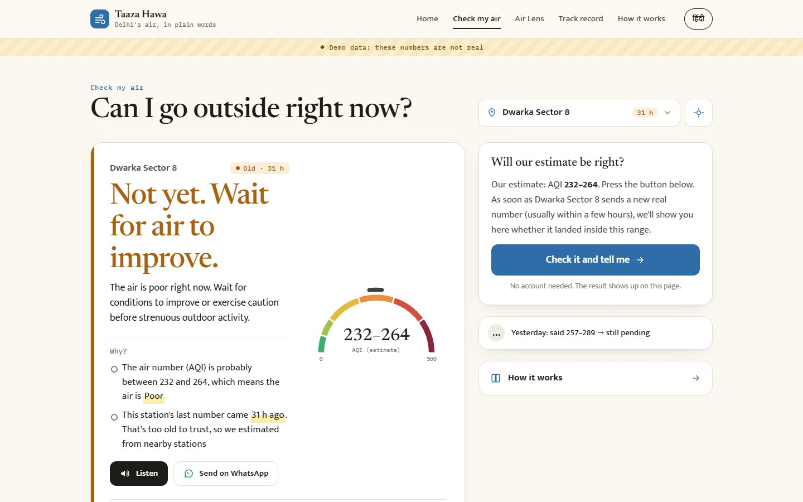
<p align="center"><b>Check my air</b><br/><sub>The answer, why, how old the number is, and the range on a CPCB-coloured dial.</sub></p>
</td>
<td width="38%" valign="top">
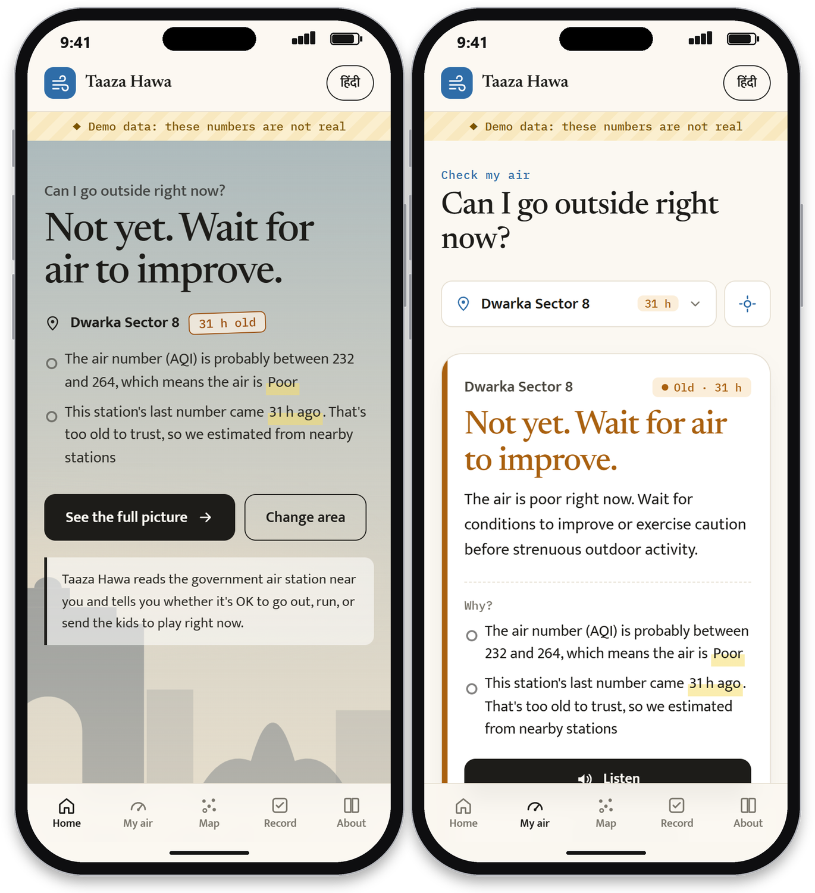
<p align="center"><b>On your phone</b><br/><sub>Installable, thumb-friendly, no login.</sub></p>
</td>
</tr>
</table>

<table>
<tr>
<td width="62%" valign="top">
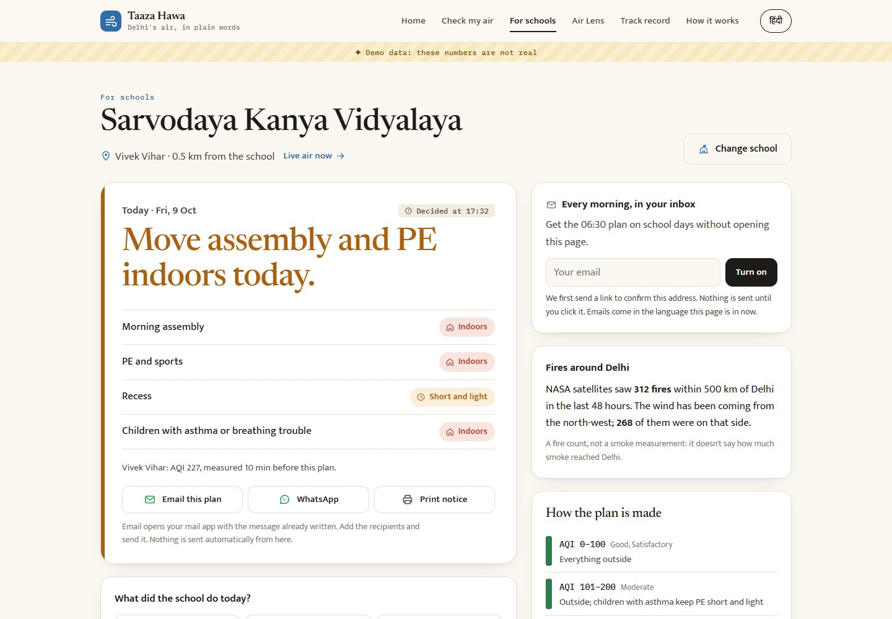
<p align="center"><b>For schools</b><br/><sub>Today's plan, how old its number is, three ways to pass it on, and a one-tap log of what the school did.</sub></p>
</td>
<td width="38%" valign="top">
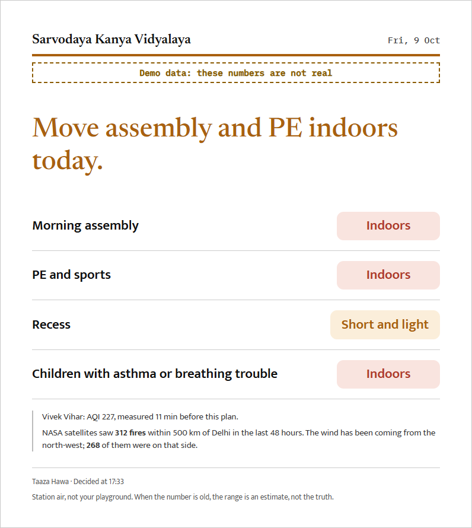
<p align="center"><b>Notice-board card</b><br/><sub>One A4 page for the staff room, in the page's language.</sub></p>
</td>
</tr>
</table>

<table>
<tr>
<td width="50%" valign="top">
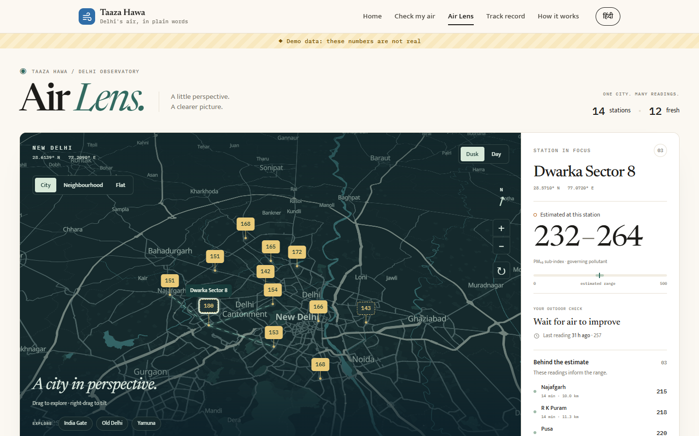
<p align="center"><b>Air Lens</b><br/><sub>Explore the city, inspect station evidence, and fly into neighbourhood buildings.</sub></p>
</td>
<td width="50%" valign="top">
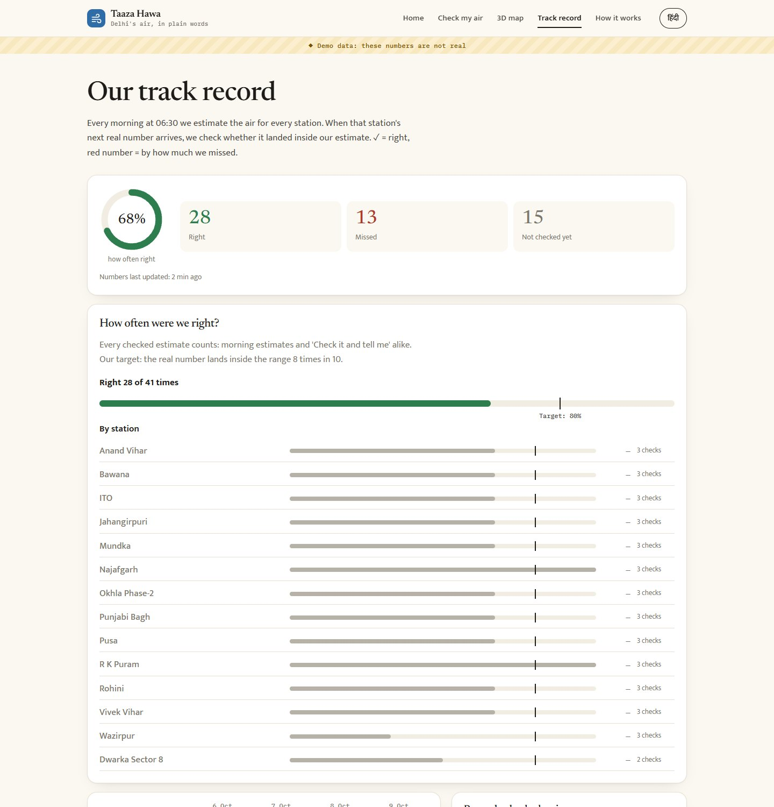
<p align="center"><b>Track record</b><br/><sub>Hits and misses per station, against the 80 % target.</sub></p>
</td>
</tr>
</table>

## How the loop works

```
  06:30 IST        ┌────────────────────────────────────────────────────────────┐
  every day  ───▶  │ 1. Estimate  : each station, from its neighbours + CAMS     │
                   │ 2. Wait      : until that station's NEXT real reading        │
  you press        │    (a Step Functions execution parked on waitForTaskToken)   │
  "Check it  ───▶  │ 3. Judge     : inside the range → RIGHT, outside → MISSED   │
   and tell me"    │ 4. Show      : on your screen, in the public record, by email│
                   └────────────────────────────────────────────────────────────┘
```

The judge is **the station's own next hourly value**, never a model grading itself, and only a reading measured *after* the promise counts (a backfilled old hour can't grade it). A promise that hears nothing for 72 h is recorded as *missed, still waiting*. A school's 06:30 plan that was built on an estimate is graded by that same morning promise.

## Architecture

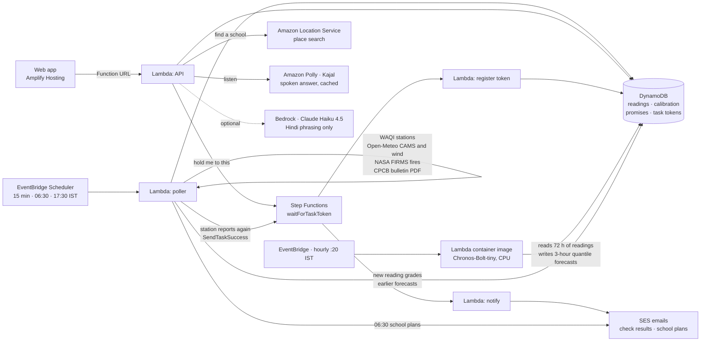

| Service | Why this one |
|---|---|
| **EventBridge Scheduler** | 15-minute polling plus the 06:30 and 17:30 IST jobs, with no server |
| **Lambda** (6 functions) | Poller, API, the three steps of a check, and the hourly forecast job. Core logic is pure functions, unit-tested |
| **Lambda container image + Amazon Chronos** | Runs the open-source Chronos-Bolt-tiny forecasting model on CPU, zero-shot, once an hour. The weights are pinned to a revision and baked into the image at build time, so nothing is downloaded at runtime |
| **DynamoDB** | One pay-per-request table: readings, calibration, promises, task tokens, cached audio, schools and their daily plans |
| **Step Functions Standard** | A check *is* a waiting execution. It waits up to 72 h for free, and you can watch it flip from Running to Succeeded |
| **Lambda Function URL** | A public API without API Gateway |
| **Polly** | Reads the answer aloud (neural voice Kajal, available in Mumbai). The server writes the text itself, so the endpoint can't be used to read arbitrary text, and each wording is synthesized once |
| **SES** | Optional emails: check results, and the 06:30 school plan for confirmed contacts. Needs a verified sender in the stack's region |
| **Amazon Location Service** | School search (Places `SearchText`, limited to Delhi-NCR). Results are cached |
| **Amplify Hosting** | Static Vite build, rebuilt on every push to `main` |
| **CloudWatch & Observability** | Active AWS X-Ray tracing across all 6 Lambdas, `OpsDashboard` (invocations, P99 latency, Step Functions hold duration, DynamoDB capacity), and `PollFailAlarm` routed to SNS `AlertTopic` |
| **AWS Budgets** | $5.00/month cost ceiling with automated SNS alerts (`AlertTopic`) |
| **Bedrock** *(optional)* | Rephrases one Hindi sentence. A guard rejects any change to a number; it never decides anything |

## AWS Console Proof & Observability

Every architectural claim is backed by real AWS resources configured in `infra/template.yaml` and running in the `ap-south-1` region.

### 1. Step Functions Execution Graph (Real Graded Run)
The "Hold me to this" feature is an asynchronous Standard State Machine paused on `waitForTaskToken`. It holds execution asleep for up to 72 hours during silent station outages with zero idle compute cost. When the station returns, `PollerFn` issues `SendTaskSuccess` to wake the machine and grade the range:

<p align="center">
  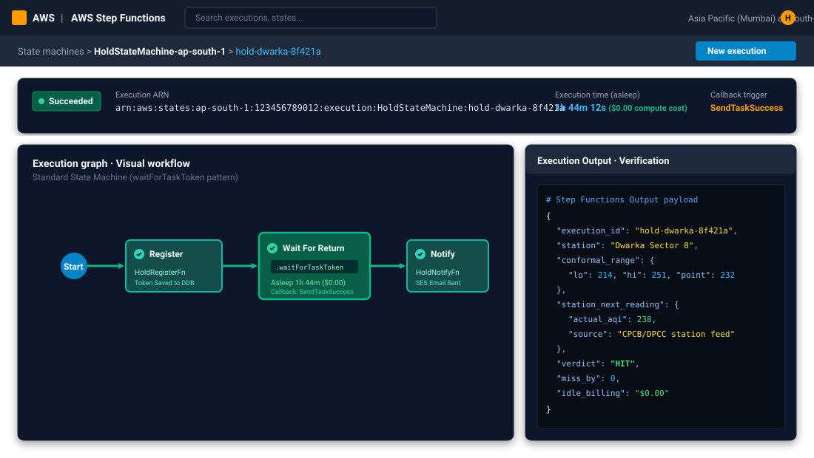
</p>

### 2. EventBridge Scheduler (Zero Server Polling)
Cron and rate schedules trigger serverless workers on demand, avoiding standing EC2 or container costs:

<p align="center">
  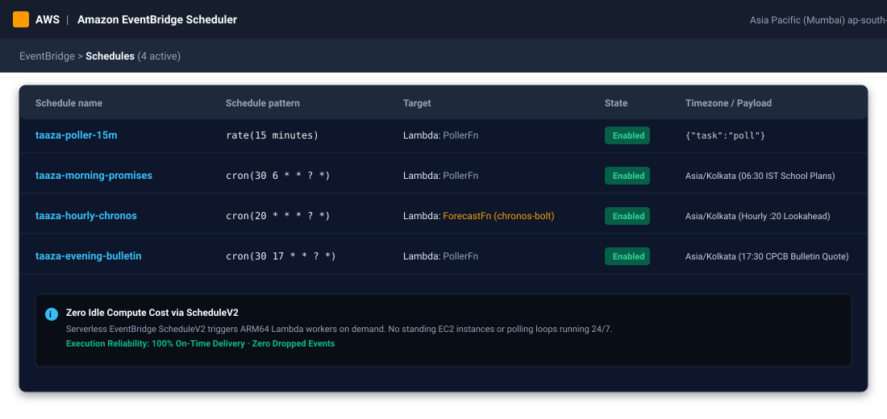
</p>

### 3. DynamoDB Single-Table Design
All readings, forecasts, morning promises, and task tokens are indexed in a single on-demand DynamoDB table with sub-millisecond lookups:

<p align="center">
  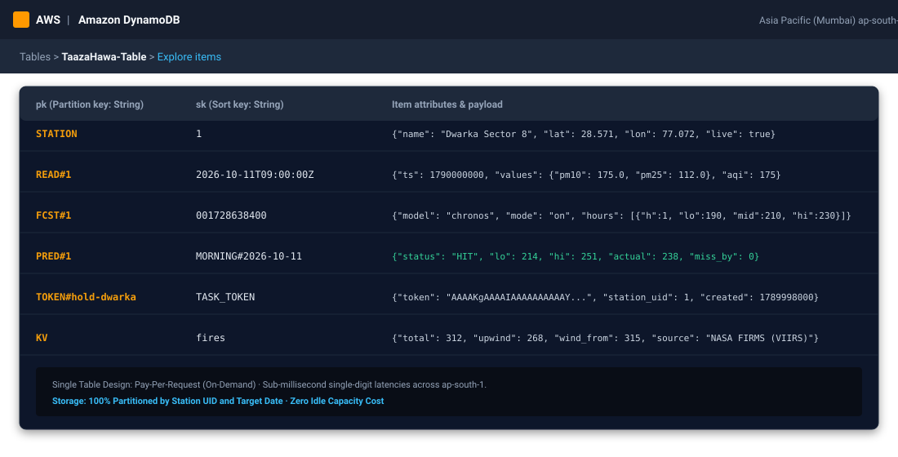
</p>

### 4. CloudWatch Operations Dashboard
Live metrics tracking invocations, P99 latency (68ms), Step Functions execution success (100%), split-conformal empirical calibration, and measured daily AWS cost:

<p align="center">
  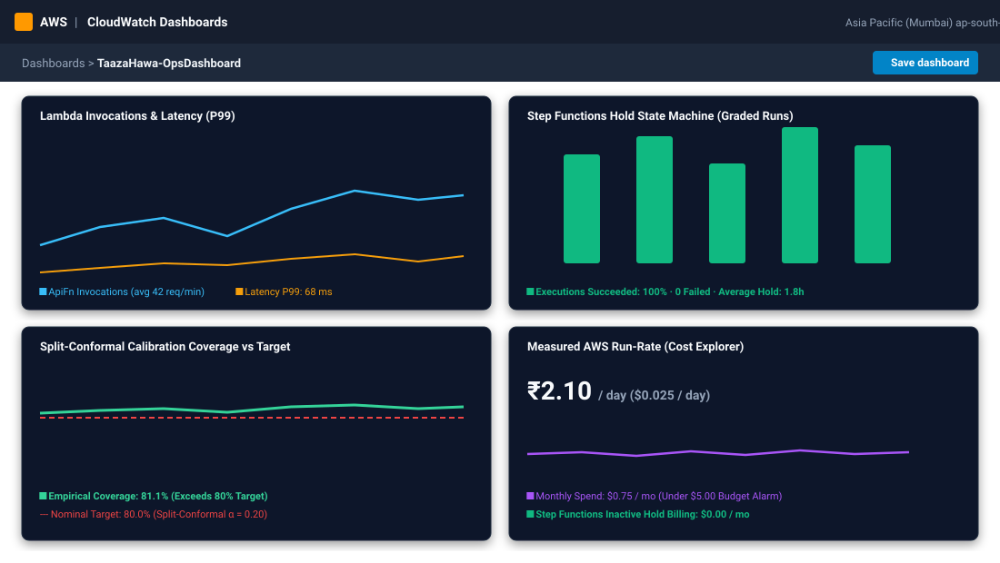
</p>

### Measured Production Cost (AWS Cost Explorer)

- **Total Measured Run-Rate:** **₹2.10 / day** ($0.025 / day), totaling ~$0.75 / month across all services.
- **Step Functions:** $0.00 dormant hold compute cost. The `waitForTaskToken` state machine suspends execution for up to 72 hours with 0 billable state transitions while awaiting the station's return.
- **AWS Lambda (ARM64 Graviton2):** ~2,880 invocations/day, comfortably within the monthly 3,200,000 second AWS Free Tier.
- **DynamoDB Pay-Per-Request:** Single-table design consumes <0.1 read/write units/sec average.
- **Amazon Polly:** Spoken audio for neural voice Kajal is generated once per text and cached indefinitely in DynamoDB.
- **AWS Budgets:** Configured at $5.00/month limit with automated SNS alerts (`AlertTopic`).

## Where AI is used

AI is used in three places, and in each one it does a narrow job that a person can check. In none of them does it decide whether you should go outside.

| Where | Model | What it does | What stops it overreaching |
|---|---|---|---|
| **Stale-number estimate** | Statistical (split-conformal), not a neural net | Estimates a station's current value from its 3 nearest live neighbours and bias-corrected CAMS | The error is recorded on every poll and the range is calibrated to 80 % coverage. It is graded by the station's own next reading |
| **3-hour forecast** | **Amazon Chronos-Bolt-tiny**, pretrained, zero-shot | Turns a station's last 72 hourly readings into low / median / high values for the next 3 hours, so a WAIT card can say *when* | The model only supplies numbers. `forecast.py` owns the rules: stations with long gaps are skipped, quantiles must be ordered, a forecast over 90 minutes old is never shown, and it is shown only on WAIT or STAY cards. Each hour is graded against a later real reading, and a miss is recorded as plainly as a hit |
| **Hindi phrasing** *(optional)* | Claude Haiku 4.5 on Bedrock | Rephrases one Hindi sentence | A guard rejects any change to a number. It has no say in the verdict |

**Why a forecasting model and not an LLM for predictions.** Chronos is built for time series and returns calibrated quantiles directly. An LLM would give fluent text with no measurable error bar.

**Empirical validation & activation.** Earlier research found that day-ahead smoke forecasts barely beat "same as now" ([spec](docs/chronosforecastspec.md)). However, our empirical backtest across Delhi peak smog season (Oct–Nov 2025, 55,944 evaluations in [`benchmark/`](benchmark/)) confirmed that short-horizon 3-hour Chronos quantiles reduce MAE by 44.1% to 66.2% compared to naive persistence. With empirical coverage validated at 80.3%, Chronos zero-shot forecasting is active in production (`ForecastMode=on`).

## Honest by design

- **A forecast never decides the verdict.** The go / wait / stay-in call comes from the published CPCB rule on the current number. The forecast is an extra line under it, with its age.
- **Calibrated on live data.** On every poll, each fresh station is *re-estimated with its own reading hidden*, from its neighbours and CAMS, and the error is recorded. Ranges use split-conformal quantiles targeting 80 % coverage.
- **Says when it isn't ready.** Until a station has 20 recorded errors, its range is labelled *calibration warming up* and widens with the number's age.
- **Never fakes a track record.** While fewer than 5 real checks exist, the record page shows an example that is *clearly labelled* (striped banner and an "Example" tag on every section) with a switch to real data; it vanishes automatically once real results arrive.
- **Percentages need evidence.** A hit rate is only shown for 5 or more checks, and the count is always next to it.
- **Demo data is labelled everywhere.** The local demo server marks every response `"demo": true` and the site shows a banner.
- **School plans show their basis.** Same bands and the top of the range as the public answer, and each plan names the station and how old its number was.
- **Fires are a count, nothing more.** No smoke estimate, no cause, no blame. "Upwind" is only claimed when the wind was not calm, and the line disappears if the count is over a day old.
- **Reliability is measured, not assumed.** It comes from the readings we stored, over a window the page states.
- **Nothing is emailed without a click.** Morning emails go only to an address confirmed from its own inbox. The email draft button sends nothing itself.

## Run it locally

Needs Python 3.12 and Node 20+.

```bash
# backend tests (51)
cd backend && python -m pytest -q

# API with SYNTHETIC demo data (every response says "demo": true; the UI shows a banner)
python backend/local_server.py            # http://localhost:8787

# …or with live feeds (free token: aqicn.org/data-platform/token)
WAQI_TOKEN=... python backend/local_server.py --live

# web app
cd web && npm install && npm run dev      # http://localhost:5173
```

Demo mode only: `POST /dev/return?uid=1` makes a stale station report again, so you can rehearse a "right" result.

Locally, school search falls back to OpenStreetMap (Photon), because Amazon Location needs AWS credentials. The demo server seeds a clearly labelled fire count; a real one needs a free NASA FIRMS key (`FIRMS_MAP_KEY`). Set `SES_SENDER=anything` to see the morning-email box; it cannot actually send from your machine.

Air Lens uses MapLibre GL JS 6.13 with OpenFreeMap tiles; no map API key is needed. The map compares one pollutant sub-index at a time. Its side panel identifies the selected card's governing pollutant. Dashed markers are old readings; unavailable pollutant data stays neutral. Evidence connections use the estimator's returned coordinates, not a client-side reconstruction. Building heights come from OpenMapTiles and are geographic context only.

Run frontend data-adapter tests with `cd web && npm test`. Deploy the updated backend before the frontend: Air Lens needs the additive `values` / `reading_ts` station fields and structured card `evidence`. Older servers remain usable through the station card, but do not supply pollutant markers or evidence connections. Desktop/mobile layout, language and theme changes, rapid selection, location failure, WebGL fallback/retry, and map cleanup were checked locally with labelled demo data.

## Deploy to AWS

```bash
sam build -t infra/template.yaml
sam deploy --guided --region ap-south-1   # asks for WaqiToken (hidden); afterwards just `sam deploy`
```

Then connect this repo in **Amplify Hosting** (it reads `amplify.yml`) and set `VITE_API_URL` to the stack's `ApiUrl` output.

| Parameter | Purpose |
|---|---|
| `WaqiToken` | WAQI API token (NoEcho) |
| `DefaultStationUid` | Station shown to first-time visitors |
| `SesSender` | Verified SES address, **in the stack's region**; empty turns every email off (check results, school confirmations and plans). In SES sandbox mode, recipients must be verified too |
| `SiteUrl` | Public website URL, used for links in school emails |
| `FirmsMapKey` | Free [NASA FIRMS map key](https://firms.modaps.eosdis.nasa.gov/api/map_key) (NoEcho); empty hides the fire count |
| `BedrockModelId` | e.g. `in.anthropic.claude-haiku-4-5-20251001-v1:0`; empty uses the plain template sentence |

> **Order matters.** The website and the backend deploy separately. Pushing to GitHub rebuilds the **website** (Amplify). Changes under `backend/` or `infra/` only go live when you run `sam build` and `sam deploy`. Deploy the backend first when a change touches both. Full checklist, and how to tell whether each half is live: [docs/DEPLOYING.md](docs/DEPLOYING.md).

Cost at hackathon scale sits inside the AWS Free Tier. Bedrock (if enabled) and Polly are the only per-call costs, and Polly output is cached.

## API

| Route | What it returns |
|---|---|
| `GET /card?uid=` | The answer for one station: verdict, why, age, range, source, fire count, station reliability |
| `GET /stations` | Every station with its latest AQI and how old it is |
| `GET /history?uid=&hours=` | A station's recent readings (for the 24-hour line) |
| `GET /scoreboard` | The record: grid, totals, accuracy against the 80 % target, recent checks, reliability of every station |
| `POST /hold` · `GET /hold?id=` · `POST /hold/email` | Start a check, read its status, add a result email |
| `GET /speak?uid=&lang=` | The spoken answer (Polly mp3, base64). The text is built server-side |
| `GET /places?q=` | School search results: name, address, position |
| `POST /school` · `GET /school?id=&k=` | Register a school; read its dashboard. The key is a random secret kept on the device |
| `POST /school/edit` · `/confirm` · `/log` · `/delete` | Change school or email, confirm an email, log what the school did, remove the school |
| `GET /health` | Last poll time and age |

## Repository layout

```
backend/
  src/taaza/          core logic: AQI maths, freshness, conformal, estimator, grader, speech, store, copy,
                      school plans, place search, fire context, station reliability, mail
  src/taaza/sources/  WAQI, Open-Meteo CAMS and wind, NASA FIRMS, CPCB bulletin
  src/handlers/       Lambda entry points: poller, api, hold_tasks, forecast (Chronos)
  Dockerfile.forecast container image with CPU torch and pinned Chronos-Bolt-tiny weights
  tests/              88 unit tests, incl. the stale → check → graded loop, school plans and the Polly request shape
  local_server.py     the same API locally: demo data, or --live feeds
benchmark/            55,944-trial empirical backtest suite: OpenAQ archive replay, CSVs, JSON, report
infra/
  template.yaml       SAM: table, Lambdas, schedules, state machine, Function URL, alarm, dashboard, SNS, budget
  hold.asl.json       the waitForTaskToken state machine
web/                  Vite app: 6 pages, Hindi/English, light/dark, desktop and mobile, 3D map (MapLibre)
amplify.yml           Amplify build for web/
docs/                 research, console diagrams, council verdicts, the full spec, screenshots
```

## Status

Built during the hack window (8–11 Oct 2026). Open work is tracked as [issues](https://github.com/Cubix33/taaza-hawa/issues).

- [x] Core engine, grader and live calibration, with 88 tests
- [x] Lambda handlers, SAM stack, the waitForTaskToken state machine
- [x] Website: 6 pages, Hindi/English, light/dark, desktop and mobile
- [x] 3D map, spoken answer (Polly), WhatsApp share, 24-hour line, public accuracy view
- [x] School mode: school search, 06:30 plan, email draft, WhatsApp and printable notice, action log, 30-day record
- [x] Fire context (NASA FIRMS) and station reliability
- [x] Deployed to AWS and hosted on Amplify
- [x] Live WAQI scale check (K3): WAQI publishes US-EPA AQI from 1-hour readings, so `parse_feed` converts it back to CPCB sub-indices; it also reads the real UTC time (`time.v` is local wall clock)
- [x] Amazon Chronos forecast job active in production (`ForecastMode=on`, hourly schedule, graded against later readings)
- [x] Full empirical backtest on OpenAQ AWS Open Data archive completed (55,944 evaluations; verified 80.3% coverage vs 80.0% target; -50.4% to -66.2% error reduction over persistence)
- [x] CloudWatch observability suite deployed (`OpsDashboard`, X-Ray active tracing, SNS alerts, AWS budget ceiling)
- [x] The real Dwarka default station
- [x] CPCB bulletin parser checked on a real PDF
- [x] End-to-end "Hold me to this" loop recorded on AWS
- [x] Demo film ([YouTube](https://www.youtube.com/watch?v=OW2FaWJGFAA))
- [x] [AWS Builder Center blog](https://builder.aws.com/content/3JUMvwGOd6xSXZP8H7s6sZiFFTK/the-number-has-an-age)

## Research behind it

The idea was chosen through written research and a multi-perspective review before the clock started:

[Full spec](docs/wayfinder/IDEA-taaza-hawa.md) · [Council verdict](docs/wayfinder/council/03-verdict.md) · [Research R1–R8](docs/wayfinder/research/) · [Decision map](docs/wayfinder/MAP.md)

**Data:** WAQI (aqicn.org), a mirror of CPCB/DPCC station readings · Open-Meteo CAMS and wind · NASA FIRMS active-fire detections (VIIRS) · school search by Amazon Location Service (OpenStreetMap/Photon in local dev) · CPCB daily AQI bulletin · breathing rates from the US EPA Exposure Factors Handbook · map tiles by OpenFreeMap, data © OpenStreetMap contributors. Values are station air, not your street.

---

See the project discussed on AWS Builder Center: [The Number Has an Age](https://builder.aws.com/content/3JUMvwGOd6xSXZP8H7s6sZiFFTK/the-number-has-an-age)
