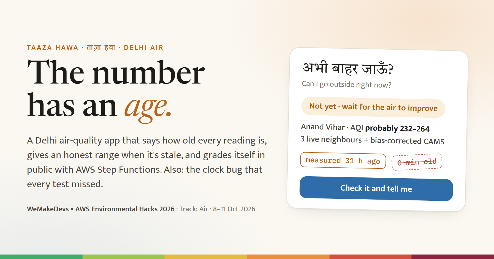
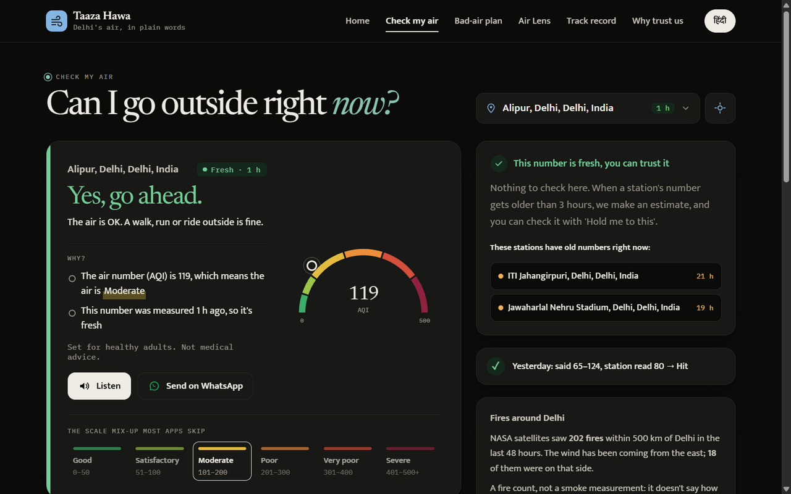
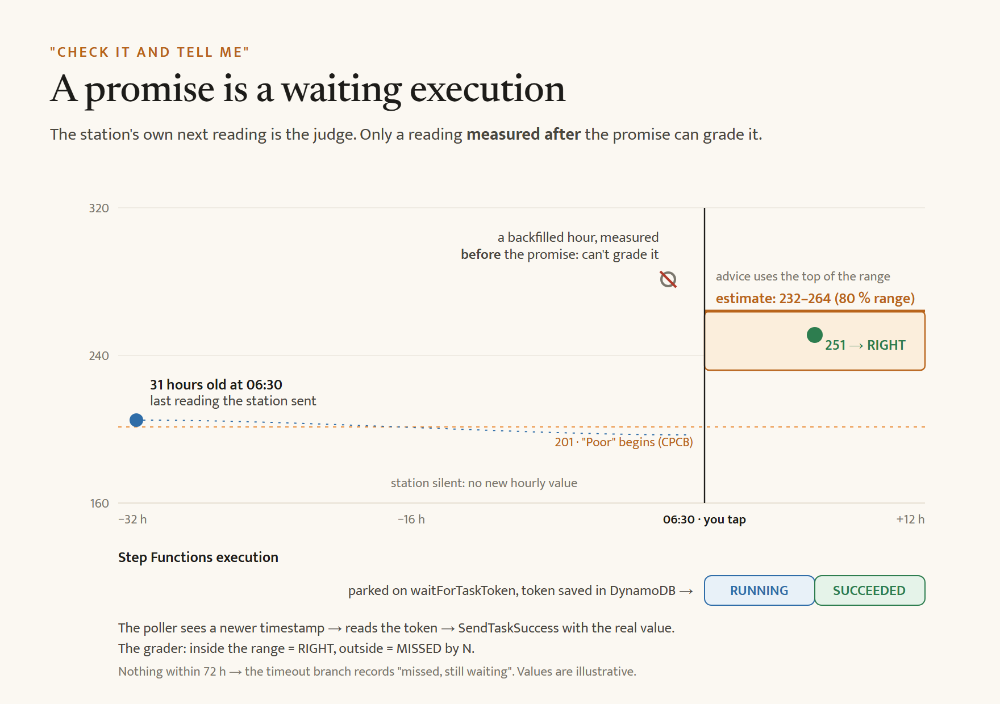
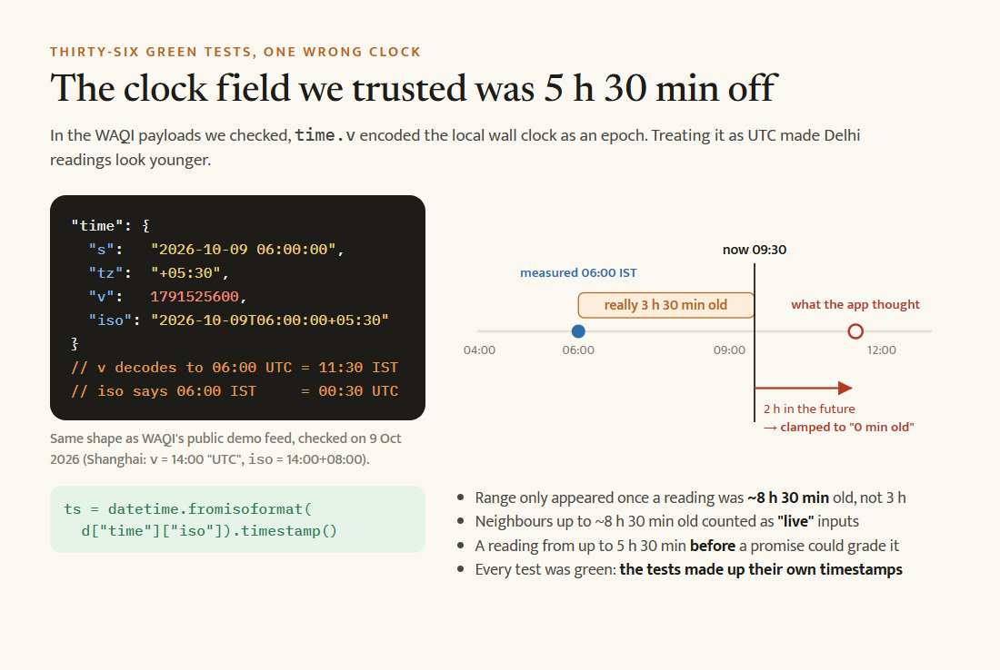
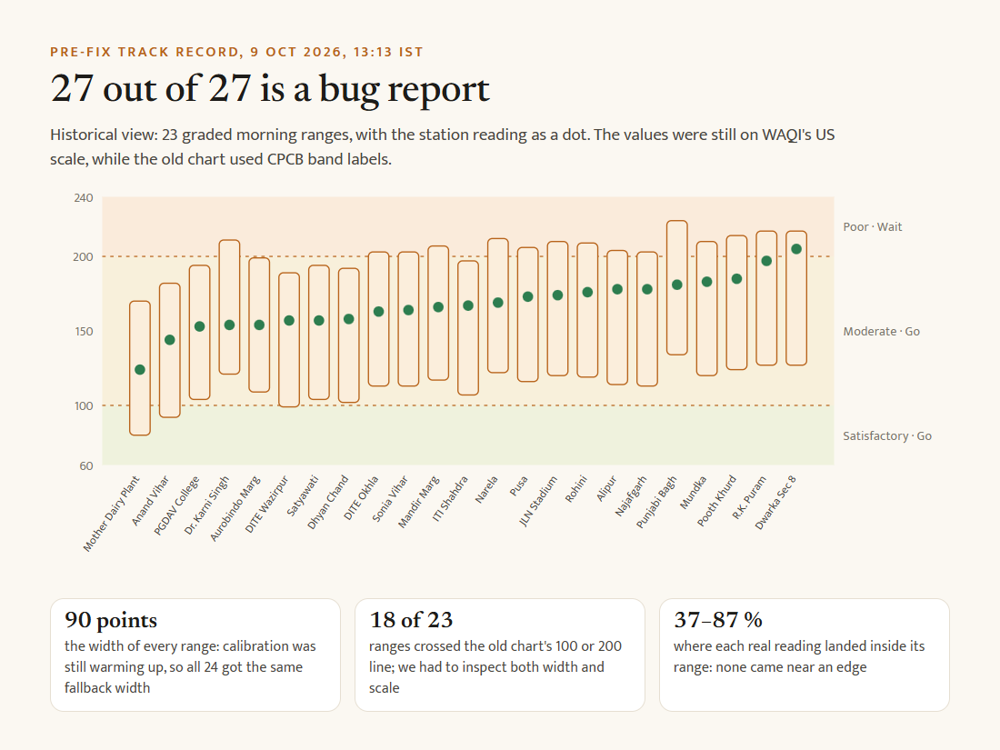
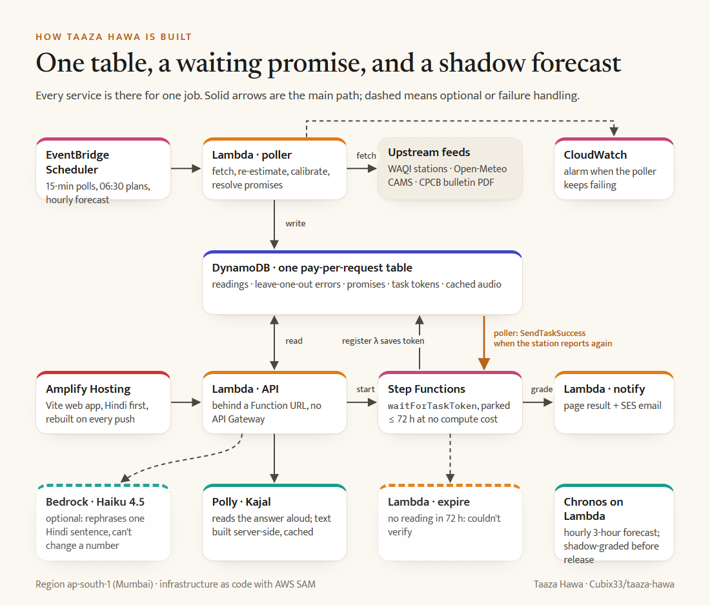

# The Number Has an Age

*We built Taaza Hawa to show Delhi residents how old an air-quality reading is, give a range when it goes stale, and check that range when the station reports again. Then our own app called old readings fresh. Here's what the live data made us fix.*



At 13:13 IST on 9 October, our live API said **22 of Delhi's 24 stations had reported 0 minutes ago**.

Twenty-two stations, all at once. We knew the feed updated roughly hourly. We had built an app called **Taaza Hawa**, or “fresh air,” around one question: how old is this number? And our answer to that question was wrong.

The next two days changed the project. We fixed the clock, found a second mistake in the AQI scale, regraded our earlier estimates, and kept the misses on the public record. The record we built to check our predictions ended up checking us.

[Try the live app](https://main.d2r1frd99buxhf.amplifyapp.com/) · [Read the code](https://github.com/Cubix33/taaza-hawa)

## It started with a morning decision

Before a run, a walk, or a ride in Delhi, I want one useful answer: should I go now? A number by itself doesn't settle it. The reading might be 20 minutes old or 20 hours old, and those are different situations.

On 4 October, our [first feed audit](https://github.com/Cubix33/taaza-hawa/blob/main/docs/wayfinder/research/R2-data-feeds-audit.md) flagged Anand Vihar and NSIT Dwarka as stale for more than a day. We later found that the audit had understated their ages by 5 hours 30 minutes because it read the same clock field incorrectly. The [CPCB bulletin check](https://github.com/Cubix33/taaza-hawa/blob/main/docs/wayfinder/research/R8-cpcb-source-staleness-check.md) recorded 43 of 46 Delhi stations participating that day. A person looking at an app still couldn't easily tell when its number was measured, or what to do when it was old.

So we gave each station card 3 things: a plain Go / Wait / Stay answer, the measurement's age and source, and a range if the reading is more than 3 hours old. The advice uses the top of that range. The app is in Hindi and English, with a spoken answer through Amazon Polly and a WhatsApp share for someone who needs the same information.


*Alipur on 11 October, after the clock and scale fixes. This is a live reading, not demo data.*

## The idea got smaller before it got useful

We first explored a “right hour for school PE” planner. The [backtest that killed it](https://github.com/Cubix33/taaza-hawa/blob/main/docs/research/03-k1-measured-backtest.md) was hard to ignore: at DTU, a model put 13:00 ozone at **191 µg/m³** while the station measured **37**. We couldn't build a precise hour picker on that gap.

We narrowed the first product to the evidence we could show. Read stations, show their age, estimate a stale value from nearby stations and bias-corrected CAMS, then let the station's next reading grade the estimate. Air Lens came later so people could inspect the stations and inputs on a map. A 06:30 school plan and a printable notice also grew out of the same rule, though we haven't measured a school using them yet.

We built an hourly 3-hour forecast with Amazon Chronos too. It runs in **shadow mode**: the app collects grades, but the forecast doesn't change the Go / Wait / Stay answer or appear as a confident “wait until” promise. It needs a record against a simple “same as now” baseline first.

## A promise that waits for the station

On a stale card, someone can tap **Hold me to this**. We save the range they saw. An AWS Step Functions Standard execution waits for that station's next reading through `waitForTaskToken`. The poller checks stations every 15 minutes, and when it sees a reading measured after the promise, it sends the result back to the execution.

```json
"ParkUntilStationSpeaks": {
  "Type": "Task",
  "Resource": "arn:aws:states:::lambda:invoke.waitForTaskToken",
  "Parameters": {
    "FunctionName": "${RegisterFnArn}",
    "Payload": { "holdId.$": "$.holdId", "token.$": "$$.Task.Token" }
  },
  "TimeoutSeconds": 259500,
  "Next": "Notify"
}
```

The register Lambda puts the token beside the promise in DynamoDB. The poller calls `SendTaskSuccess` when a qualifying reading arrives; the notify Lambda records the result and can send an optional email. The [full state machine](https://github.com/Cubix33/taaza-hawa/blob/main/infra/hold.asl.json) also handles a timeout. If no newer reading arrives within 72 hours, the page says **couldn't verify** and excludes it from the hit rate.


*The station's next reading grades the saved range. Diagram values are illustrative.*

The rule behind the judge fits in one line of [code](https://github.com/Cubix33/taaza-hawa/blob/main/backend/src/taaza/grader.py): `reading_ts > created_ts`. A backfilled older hour can't grade a promise we made later. That one line became much more important once we found the clock bug.

## The clock made old air look fresh

WAQI returned a timestamp with both a numeric `v` and an offset-bearing `iso`. We treated `v` as a UTC Unix timestamp. In the [public WAQI demo feed](https://api.waqi.info/feed/shanghai/?token=demo), the two fields disagreed by exactly the local time-zone offset: `v` encoded the wall clock as if it were UTC, while `iso` identified the actual instant. That's what we observed in the feed, so we now parse `iso` and use `tz` with `v` only as a fallback.

For Delhi, the error was **5 hours 30 minutes**. At 13:32 IST on 9 October, Alipur's 13:00 station reading was stored as 18:30. Our age function then turned a future timestamp into `0 minutes` with `max(0, ...)`. A guard against negative display values had hidden the evidence.


*The old parser shifted Delhi readings 5 hours 30 minutes forward. The age clamp displayed them as 0 minutes old.*

| What changed | Before | After |
|---|---:|---:|
| Stations shown as 0 minutes old | 22 of 24 at 13:13 IST, 9 Oct | 0 of 24 at 13:06 IST, 11 Oct |
| A reading entered the “more than 3 hours old” branch | About 8 hours 30 minutes after measurement | After 3 hours |
| A neighbour could count as recent | Up to about 8 hours 30 minutes old | Up to 3 hours old |

The bug reached the public grading record as well: a reading taken before a promise could appear to have happened after it. Our migration moved stored readings to the real UTC time, converted their scale, and regraded saved promises using the first station reading actually measured after each promise. It also restarted calibration on the corrected data. [The regression tests](https://github.com/Cubix33/taaza-hawa/blob/main/backend/tests/test_scale_and_clock.py) use the observed WAQI payload and cover that migration.

We had **36 green tests** before finding this. Our backend timestamp tests used values we had made up; none parsed the real payload. The lesson was painful and specific: when time is part of the product, an external timestamp needs a real-feed test.

## The number had the wrong scale too

The clock check led us to another assumption. WAQI's pollutant fields are [individual AQI values](https://aqicn.org/api/) on its [US EPA scale](https://aqicn.org/scale/). Our decision rule uses India's CPCB bands. We were feeding one scale into rules written for the other.

At 13:13 IST on 9 October, our conversion would have turned **5 of 24 “Go” answers** from the old implementation into “Wait”. The fix sits at the [WAQI parser](https://github.com/Cubix33/taaza-hawa/blob/main/backend/src/taaza/sources/waqi.py): turn each reported pollutant index back into an estimated concentration using WAQI's scale table, then compute the CPCB sub-index before any advice or range uses it. The site now explains that scale change on the Check page and the Why trust us page.

This is a conversion from a published index, not a fresh measurement of pollutant concentration. It has limits. Still, applying the same scale to the displayed number, the range, and the decision rule removes a disagreement we created ourselves.

## Why trust a record that once said 27 out of 27?

On 9 October, the public page said **27 checks, 27 right**. That looked reassuring until we opened the ranges. Many were still using our **±45-point warm-up band**. Some were wide enough to cross an AQI category boundary. The timestamp bug had also allowed some checks to be graded by the wrong station hour.


*The early record on 9 October, before the timestamp and scale fixes. Its US-scale values were still shown under CPCB band labels, which is part of why we rechecked it.*

We target 80% coverage, so a short perfect run proves very little. After the migration, the record includes real misses. At **13:06 IST on 11 October**, the [live scoreboard](https://main.d2r1frd99buxhf.amplifyapp.com/#/record) showed **66 hits in 74 graded checks, 8 misses**. Of those 74, **51** were made while calibration was warming up; their mean range width was **186 AQI points**. The rate will change as more readings arrive, and those wide early ranges should make anyone cautious about celebrating it.

Our live calibration has a simple check on itself. When a station reports, we hide that station's new value, estimate it from its neighbours and CAMS, and record the error against what the station actually said. Once a station has 20 such errors, the range uses their observed spread to target 80% coverage. Until then, the UI says **calibration warming up**. A station that never reports again produces an unverified check, not a miss.

The trust case is visible and limited: the source, measurement time, estimate inputs, saved range, station result, and misses are all open to inspection. We also show [the clock and scale fixes](https://main.d2r1frd99buxhf.amplifyapp.com/#/about) that made our first record unreliable.

## One AWS job for each part of the loop


*AWS SAM deployment in ap-south-1. The forecast job is shadow-graded before it is shown as advice.*

| Service | Job |
|---|---|
| EventBridge Scheduler | Run 15-minute polls, morning plans, the bulletin job, and hourly forecasts. |
| Lambda | Fetch and process readings, serve the API, manage check executions, and run Chronos in a separate container job. |
| DynamoDB | Hold readings, calibration errors, promises, task tokens, school plans, and cached audio. |
| Step Functions Standard | Keep each check waiting for a station reading, up to 72 hours. |
| Polly and SES | Read a server-built answer aloud; optionally email a check result or confirmed school plan. |
| Amplify Hosting | Serve the web app. |
| CloudWatch | Alarm on repeated poller failures. |

The app has a Lambda Function URL for its API. Bedrock can rephrase one Hindi sentence if enabled, but a guard rejects a changed number and the model never chooses the verdict. Chronos is a separate, shadow-mode forecast. The ordinary Go / Wait / Stay rule remains a fixed table.

## What we can say, and what we can't

Taaza Hawa describes air at a named station. It can't measure your street or settle what a home sensor sees. A range is an estimate, and an 80% target still allows misses. The adult activity answer is a simple rule for healthy adults, not medical advice. The school plan is built and printable, but we haven't measured whether a school has used it or changed a decision because of it.

We learned to keep those limits on the screen, close to the answer. A beautiful card can make a weak number feel certain. Its age, source, scale, and track record need to be just as easy to see.

## What we'll take into the next build

1. **Test the feed you actually receive.** A real WAQI timestamp fixture would have caught our 5-hour-30-minute error before the first deploy.
2. **Inspect perfect scores.** Look at range width, sample size, and which observation did the grading before calling a hit rate good.
3. **Keep the judge independent.** The station's later reading grades the estimate; a timeout stays unverified.

Open the [live app](https://main.d2r1frd99buxhf.amplifyapp.com/), pick a station, and look at the age beside its AQI. If that reading is over 3 hours old, you can save the range and watch it get checked. The [repo](https://github.com/Cubix33/taaza-hawa) includes the AWS SAM stack and tests.

*Built during WeMakeDevs × AWS Environmental Hacks, 8–11 October 2026. Data: WAQI (aqicn.org), Open-Meteo CAMS, CPCB bulletin, and OpenFreeMap / OpenStreetMap map data. Claude Code and Codex assisted with implementation, review, and writing; the technical claims here were checked against the code and dated live API responses.*
