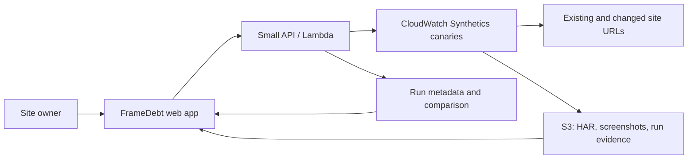

# FrameDebt — load the interaction when the visitor needs it

**Hackathon:** [WeMakeDevs × AWS Environmental Hacks, Oct 8–11, 2026](https://www.wemakedevs.org/aws/env)  
**Track:** Waste & Energy  
**Status:** Provisional solo, software-only fallback; [environmental-fit review](decision-review-2026-10-04.md) reopens the final event choice  
**Owner/demo subject:** Harshdip's existing [portfolio](https://harshdipsaha.tech/)  
**Concept score:** Five-advisor council rated demo potential about 8/10 conditional; the later [decision review](decision-review-2026-10-04.md) says that was too generous as an environmental-hackathon winning estimate

The complete [research and source audit](research/05-solo-software-search-and-framedebt.md) and [five-advisor council transcript](council/round-3-solo/00-framed-question-and-anonymized-responses.md) explain how this replaced the earlier ideas. The [final council addendum](council/round-3-solo/01-peer-reviews-and-verdict.md) records every reassessment.

## 1. The problem in one sentence

When a visitor opens an image-rich page, the browser can download an entire interaction before the visitor reaches it, spending bandwidth and time without giving that visitor anything yet.

**The person and moment:** A developer opens their own portfolio on a phone, before scrolling to its MRI viewer, and sees 160 frames arrive anyway. The owner can fix and publish the site without asking a teacher, principal, cleaner, or any other professional to participate.

**The 15-second pitch:** “My portfolio sent 160 MRI frames—about 2.55 MB—before I touched the MRI viewer. FrameDebt shows the premature requests, changes the loading sequence, then independently verifies that first load is lighter and the full viewer still works.”

## 2. What is observed, and what remains a hypothesis

In **one** browser first-load inspection of `harshdipsaha.tech` before scrolling, Resource Timing showed 204 resource entries and **3,461,954 transferred bytes across those entries**, excluding the navigation document (14,630 further observed bytes). The `/brain/1080/*.webp` sequence made **160 requests and transferred 2,553,866 bytes**, or **73.8% of the resource-entry total**. The MRI viewer is farther down the page. This is direct exploratory evidence of early delivery in that run.

Repeat the measurement with controlled cache, viewport and network settings and corroborate it with network/HAR artifacts. No after-change result exists. The 2.55 MB must be described as **currently transferred before the interaction**, not as energy, CO2, or even permanent bytes saved. If a visitor later explores all 160 frames, most bytes may be delivered later. The core measured outcome is **less transfer on a defined no-scroll visit**, with the full-scroll experience protected.

## 3. The product

**FrameDebt** is a web app for a site owner. The owner provides a URL and defines an interaction boundary, initially “before the MRI section enters the viewport.” The app runs a baseline no-scroll and full-scroll journey, groups network requests by sequence, highlights files transferred before their first possible use, and proposes a *specific* bounded-prefetch change for this site's MRI loader. The owner reviews and applies the change to an isolated preview/deployment. AWS then repeats the same journeys and issues a pass/fail receipt with raw trace links.

The first release is **one supported integration**, the user's site and its 160-frame MRI component. A generic URL may be scanned, but the app must not claim that it can safely rewrite any site's code. A suggested code/config patch is only an intervention once the owner applies it and the independent canary tests it.

### Closed loop

1. **Sense:** Record network requests and the viewer's first visible/use moment on the existing page.
2. **Decide:** Flag resources that arrived before that moment; require the owner to inspect the exact URLs and a bounded-prefetch proposal.
3. **Act:** Owner deploys the reviewed loader change to a real preview or production URL. The UI names which URL was actually tested.
4. **Confirm:** AWS canary reruns no-scroll and full-scroll visits with matched settings, collects trace/screenshot evidence, checks for missing or late frames, and publishes **pass, fail, or inconclusive**.

No LLM computes the result or declares a win. AI is optional for plain-language explanation of a deterministic report; skip it if it adds failure modes.

## 4. Exact website experience

This is a **developer workbench** with a visual network story, not another personal portfolio. The landing page can show a real example receipt, but every prominent number must link to a real run. A calm, precise layout suits a developer diagnosing a page: light canvas, high-contrast request timeline, large before/after figures, and screenshots of the MRI viewer. Internal AWS service names live in the method view, not the main action card.

| Route/screen | What the user sees | Primary action |
|---|---|---|
| `/` landing | Headline: **“160 frames arrived before the visitor did.”** A short live network timeline and one measured example, timestamped “one exploratory run” until a controlled run exists. A **Try my site** field and **Watch the 90-second proof** entry. | Start a scan. |
| `/scan` source | URL, site ownership/authorization statement, test settings (desktop/mobile viewport, cache state, network profile), and interaction marker (“MRI enters viewport”). A status chip distinguishes queued/running/failed. | Run baseline. |
| `/runs/:id` finding | Split timeline: visitor at top vs network requests. Big evidence: **160 frames / 2.55 MB before scroll** *only when the run supports it*. Request list, filenames, timing, screenshot at top, and explanation of why those frames are not yet usable. | Review proposed change. |
| `/change/:id` intervention | A specific loader diff/config plan: demand-load the current frame; keep a bounded ahead/behind prefetch window; avoid unbounded eager preload; retain continuity at normal scroll speed. Scope and deployment URL are explicit. One **Approve and test preview** control only if deploy integration exists; otherwise **Copy patch / mark deployed URL**. | Owner applies and confirms the target URL. |
| `/compare/:id` verification | Matched **before/after, no-scroll/full-scroll** grid. Initial transfer, frame-request count before marker, full-journey bytes, missing/late-frame count, and full-viewer playback evidence. Red regressions are as visible as green gains. | Open receipt. |
| `/receipt/:id` judge proof | **PASS / FAIL / INCONCLUSIVE**, timestamp, run settings, tested URLs/build IDs, before/after bytes, screenshot pairs, raw HAR/network artifacts, and exact definitions. Claim text: **“X bytes deferred on an arrival-only visit.”** | Replay the evidence; open raw artifacts. |
| `/judge` | “How to judge this in 90 seconds”: one real baseline, one real changed build, no-scroll and full-scroll canary links, and architecture with reasons. If the changed build is unavailable, show the failure rather than fabricated green numbers. | Inspect the live case. |

**Mobile:** The site owner can inspect the receipt on a phone. The dense waterfall may use a compact summary there, with request details expandable. The demo can be screen-recorded by one person using a laptop/browser and the user's existing site; no second actor or physical device is required.

## 5. Measurement contract and honest receipt

**Unit of comparison:** browser journey, not a whole website or a person. The two journeys are (A) navigate, wait for a fixed settle period, do not scroll; and (B) navigate, scroll through all 160 slices using the same scripted path. Before and after runs must match viewport, browser/runtime, cache policy, scroll script, network profile, and settle time. Record each run's configuration and timestamps. Do multiple trials and show the distribution, not just the best run.

**Primary pass:** substantial reduction in transferred bytes and frame requests during journey A, corroborated by network trace. **Guardrail:** journey B must show no missing/blank frames and no material regression in frame latency, scroll smoothness, or total transfer. An inconclusive trace, error, untested deployment, different settings, or failed visual guardrail cannot produce a green receipt.

**Definitions:**

- `premature bytes`: transfer associated with a known interaction sequence before its interaction marker in a particular run.
- `bytes deferred`: the before-minus-after transfer in the **no-scroll** journey, when requests are shifted until use. It is a journey-specific comparison, not a permanent environmental saving.
- `bytes avoided`: use this phrase only if the defined journey ends without requesting those files and the comparison confirms it. Do not extrapolate from one synthetic journey to real visitors without traffic data.
- `energy / CO2 saved`: **not measured**. Do not put a conversion in the main product receipt. The [IEA cautions against simplistic data-to-carbon calculations](https://www.iea.org/commentaries/the-carbon-footprint-of-streaming-video-fact-checking-the-headlines).

## 6. AWS architecture: each service has a job

| Need | AWS choice | Why it earns its place |
|---|---|---|
| Independent browser replay | [CloudWatch Synthetics canary with Puppeteer](https://docs.aws.amazon.com/AmazonCloudWatch/latest/monitoring/CloudWatch_Synthetics_Canaries_WritingCanary_Nodejs_Pup.html) | AWS runs the same scripted arrival and scroll journeys after deployment, rather than trusting the app's own green assertion. Capture step results, network artifacts and screenshots. |
| Evidence retention | S3 artifacts from canary | Raw trace and screenshot evidence can be inspected; receipt numbers have a source. |
| Run orchestration/comparison | Lambda or a small hosted API | Starts runs, validates matching settings, computes byte/frame comparisons and a deterministic pass/fail. No model authority. |
| Public product | Amplify Hosting or another AWS web host | Makes the workbench and judge path available. The monitored portfolio itself may remain on its existing host; the canary's AWS role is real either way. |

Use one simple metadata store only if needed. Avoid adding Bedrock, Step Functions, or multiple AWS services merely to increase a count. The [official canary documentation](https://docs.aws.amazon.com/AmazonCloudWatch/latest/monitoring/CloudWatch_Synthetics_Canaries.html) supports scripted monitoring; exact runtime/API behavior must be checked during implementation.

## 7. Three-minute solo film

| Time | Film an actual event |
|---|---|
| 0:00–0:25 | Open the owned site at the top. Keep hands off scroll. Show 160 MRI requests appearing in the browser network view and explain why a visitor cannot use those frames yet. |
| 0:25–0:55 | Run FrameDebt baseline. Click the grouped MRI sequence; show filenames, transfer and first-use marker. |
| 0:55–1:30 | Show the exact bounded-prefetch change and the **real** preview/deployment URL. Apply a genuine change live if reliable, or cut honestly to a separately deployed build with build IDs visible. |
| 1:30–2:10 | Start the independent AWS check. Show the no-scroll before/after request count and transfer, then scroll the whole MRI sequence with no blank frames. |
| 2:10–2:40 | Open the signed-by-evidence receipt: settings, pass/fail, screenshots, HAR, and AWS console run. |
| 2:40–3:00 | State the measured claim and one hard limit: a full viewer visit may still download every frame. |

The hook, action and confirmation happen on the user's own site. No principal, teacher, sweeper, field visit, borrowed hardware, or staged professional endorsement is needed.

## 8. Four-day build boundary

**Before Oct 8:** research, source access check, baseline rehearsal, canary documentation/account setup. The [event rules](https://www.wemakedevs.org/aws/env) say project work starts with the clock; do not build the entry or change the site's loader early.

**Oct 8:** record controlled baseline on existing site; implement a simple scanner that groups the MRI requests; create a clear result page. **Oct 9:** implement the site-specific bounded loader change on a preview; make the full viewer work. **Oct 10:** make CloudWatch canary run both journeys and store artifacts; build deterministic receipt; rehearse solo film. **Oct 11:** repeat matched tests, fix regressions, record and submit the actual app/console, and publish a short engineering write-up if the event permits.

Scope cuts in order: generic site support, automated code rewriting, AI explanation, carbon estimator, multiple viewer patterns. Keep the measured before/after run and full-scroll guardrail. The first intervention should be code that the entrant owns and can deploy.

## 9. Competition readout and kill conditions

The [winner playbook](WINNER_PLAYBOOK.md) rewards a one-sentence moment, on-camera event, closed loop, deterministic truth, purposeful AWS, honest failure states, and a short live demo. FrameDebt can satisfy these with a solo actor. It still risks looking like “lazy loading with extra steps.” The product must actually detect *premature interaction assets*, run a safe intervention, and verify the complete interaction; a Lighthouse-style weight report or a hand-edited before/after slide would not meet this bar. [Chrome already documents offscreen-image deferral](https://developer.chrome.com/docs/lighthouse/performance/offscreen-images).

**Kill or downgrade the idea if:** repeated cold arrivals do not reproduce the 160-frame burst; the code/deploy path is unavailable; bounded prefetch causes blank or late slices; AWS canary cannot capture matched network evidence in time; or the demo cannot show a real action and receipt. Fail visibly rather than inventing results. An **8/10 concept** becomes a competitive entry only if those gates pass during the hack.

**Why the earlier ideas are parked:** The PE intensity planner turns mainly into an AQI-band lookup, requires a real school actor for a meaningful action, and depends on self-reported compliance and modeled inhaled-air benefit. The [archived PE statement](PROBLEM_STATEMENT_right-hour-pe-archived.md) records it. Saaf Twin had a compelling physical response but violates the explicit **software-only** rule; see [hardware archive](PROBLEM_STATEMENT_saaf-twin-hardware.md). PulseProof seemed promising until the only demoable load was a fan or lights, making a clear meter-pulse effect uncertain and placing it beside existing pulse-reader apps. The [full council record](council/round-3-solo/01-peer-reviews-and-verdict.md) preserves the changes of view.

## 10. Evidence and limits to cite in the submission

- Owned-site exploratory browser observation and exact counts: [research log](research/05-solo-software-search-and-framedebt.md). Recheck under controlled conditions before using a headline number in the final video.
- Web-scale context: [HTTP Archive 2025 Page Weight](https://almanac.httparchive.org/en/2025/page-weight). Existing practice: [Chrome offscreen-image guidance](https://developer.chrome.com/docs/lighthouse/performance/offscreen-images).
- Empirical research: [Liu et al. 2016](https://arxiv.org/abs/1605.06678), [Rani et al. 2024](https://arxiv.org/abs/2401.06482), [Horn et al. 2023](https://arxiv.org/abs/2308.16734), [Gonçalves et al. 2022](https://arxiv.org/abs/2205.11399). These motivate measurement discipline; none measures FrameDebt's emissions.
- AWS verification: [CloudWatch Synthetics](https://docs.aws.amazon.com/AmazonCloudWatch/latest/monitoring/CloudWatch_Synthetics_Canaries.html). Carbon caution: [IEA](https://www.iea.org/commentaries/the-carbon-footprint-of-streaming-video-fact-checking-the-headlines).
