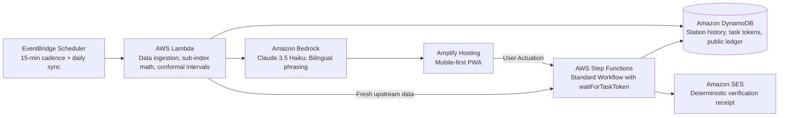

# Engineering & Design Playbook — WeMakeDevs × AWS Environmental Hacks (Oct 8–11, 2026)

> High-performance architecture and execution principles for building an impactful, deployed environmental system on AWS.
> Built from first-principles analysis of the official judging rubric, AWS cloud best practices, and Delhi-NCR environmental ground truth.

---

## 0. Hackathon Context & Format

| Dimension | Specification |
|---|---|
| **Theme** | **Environment only**: Air · Heat & Water · Waste & Energy |
| **Competition Structure** | **Each track judged separately**: 3 Track Winners (₹2,00,000 cash + $2,000 AWS credits each), 4 Runners-up, Top 10 students receive fast-track Amazon interviews |
| **Field Size** | 5,006 registered participants |
| **AWS Requirement** | Mandatory: Deployed on AWS or built using AWS open-source tools (*"projects built locally and deployed on AWS are scored with the same care"*) |
| **Judging Priority** | **Idea & Impact listed first**: *"A small problem solved well beats a big one solved vaguely."* |
| **Event Timeline** | Project work starts when the clock starts (Oct 8 08:00 – Oct 11). Pre-event research, account provisioning, and architectural planning are encouraged before the clock. |
| **Demo Medium** | **3-minute recorded video**: *"The video is what the judges see."* (No live Q&A demo). |
| **Hybrid Venue** | Delhi Technological University (DTU), Saturday Oct 10 (optional in-person build day, AWS team workshops, and mentor feedback). |

---

## 1. Five Critical Anti-Patterns to Avoid

1. **The Ghost Demo**: Spending 2+ minutes on slides and problem context with zero or minimal live product footage.
2. **Read-Only Verdicts**: Stopping at "Your AQI is 250" or "You are eligible" without closing the loop into an actionable, verified human outcome.
3. **Silent AI Failures**: Relying on unconstrained LLM calls that hallucinate, fail under rate limits, or leak raw programming syntax.
4. **Dev-Portfolio Bias**: Dense screens, dark hacker aesthetics, raw JSON drawers, and English-only jargon on a surface meant for ordinary citizens or field operators.
5. **Resume-Padding Architecture**: Gluing AWS services together without a load-bearing reason for each service.

---

## 2. The 10 Principles of High-Impact Hackathon Engineering

### P1. One Person, One Moment, One Sentence
The problem statement must take under 15 seconds to articulate.
- *Test:* Can you name the person, the hour, and the physical place in one sentence?
- *Negative:* "Delhi residents facing toxic winter air." (Vague, unmeasurable).
- *Positive:* "A morning runner in Dwarka at 6:30 AM deciding whether to run or stay indoors based on a monitor reading that is secretly 31 hours stale."

### P2. The Observable Camera Event
The demo must feature an event that happens on camera where real-world state or physical truth changes, not merely a screen tour of a web form.
- *Test:* Is there a distinct moment where a real phone buzzes, a sensor reacts, an AWS console flips from blue to green, or an environmental threshold actuation takes place in real time?

### P3. Close the Loop
Every complete system must follow: **Sense → Decide → Act on a human → Confirm → State changes**.
- A notification or recommendation must be acknowledged by a human actor, which deterministically transitions the system state and verifies the outcome.
- AWS provides this natively via **Step Functions `waitForTaskToken`** (pausing workflow at zero compute cost) and **EventBridge Scheduler** (escalation upon timeout).

### P4. Deterministic Systems Decide; AI Explains
AI must never be the unconstrained decider of facts, environmental compliance, or legal bands.
- Deterministic formulas (CPCB AQI sub-index formulas, government gazette rules, conformal prediction boundaries) make the decision.
- Generative AI models (e.g. Amazon Bedrock) extract structured data from unstructured inputs or format decisions into persona-native Hindi/English summaries.

### P5. Load-Bearing AWS Architecture
Every service in the architecture diagram must answer the question: *"Why this service, and not an open-source library or another AWS service?"*
- Examples:
  - **Step Functions `waitForTaskToken`**: Pauses state machines for hours/days waiting for upstream data arrival without polling compute cost.
  - **EventBridge Scheduler**: Millisecond-accurate serverless invocation for periodic scrapes and sweeps.
  - **DynamoDB Single-Table**: High-throughput, sub-10ms key-value lookups with native TTL for transient readings.

### P6. Degrade Loudly, Never Fake
Every external dependency (data mirrors, APIs, LLMs) must have an explicit health status.
- If a data feed is stale, display its exact age in plain language (*"Feed is 31 hours old"*).
- If an LLM is offline or throttling, fall back immediately to deterministic templates with a visible status indicator.

### P7. Persona-Native Interface Design
User interfaces must be designed for the human living with the problem:
- Single primary decision per screen.
- High contrast, large touch targets, readable in direct sunlight on entry-level Android devices.
- Native bilingual support (Hindi first, English toggle).
- Zero technical jargon (no "task tokens", "CAMS 0.4°", or "API responses" on citizen surfaces; save technical proof for a dedicated Audit/Judge tab).

### P8. Built to be Run (Production Readiness)
The repository should demonstrate genuine software craftsmanship:
- Infrastructure as Code (AWS CDK / SAM) for one-command deployment.
- A **"How to Judge This in 90 Seconds"** path with preloaded demonstration scenarios.
- Live public counters (e.g. Total Scrapes, Active Hold Promises, Hit/Miss Ratio).

### P9. Video Choreography (3-Minute Shape)
| Timestamp | Content | Visual |
|---|---|---|
| **0:00 – 0:20** | Person + Moment + Stakes (P1) | Real person / location, direct to camera. Zero slides. |
| **0:20 – 1:30** | The Core Event & Closed Loop (P2/P3) | Real phone screen, live interaction, system actuation. |
| **1:30 – 2:20** | AWS Architecture & Real Console | Diagram highlighting *why each service*, cutting to live AWS Management Console showing the execution that just ran. |
| **2:20 – 2:45** | Public Proof / Scoreboard | Aggregated verification ledger proving the system runs continuously. |
| **2:45 – 3:00** | Engineering Insight ("What fought back") & Tagline | Honest lessons learned regarding upstream data lag or API limits. |

### P10. Coined Core Concepts
Give your architectural breakthroughs memorable, domain-specific names:
- Examples: *"Taaza Badge"*, *"Hold Me To It"*, *"Hawa Hold"*, *"Proof of Breath"*. Memorable names create cognitive anchors during judge deliberations.

---

## 3. Systematic Problem Discovery Framework

### Step 1: Search for Friction, Not Topics
Look for operational friction where rules exist, public data exists, but human execution breaks down:
- **Public audits & RTI queries**: Discover where official action plans fail in real-world practice.
- **Jurisdictional confusion**: Gaps between municipal bodies (e.g. PWD vs MCD drains; CAQM vs DPCC enforcement).
- **Time-varying restrictions**: Rapidly changing rules (GRAP stages, school hybrid notices, construction stops).
- **Public sentiment analysis**: Ground-level outrage on local forums regarding discrepancy between official reports and perceived reality.

### Step 2: Apply the 6-Point Filter
1. Can the problem be stated in one sentence with a person, hour, and place?
2. Can a real physical or observable event be demonstrated on camera?
3. Does the system close a loop with human verification?
4. Is there an authoritative, deterministic ground truth?
5. Does each AWS service have a load-bearing architectural reason?
6. Can a solo builder deploy a working prototype within 4 days?

### Step 3: Eliminate Clichés
Judges evaluate dozens of predictable concepts:
- Generic AQI dashboards with color scales.
- "Chatbot that answers environmental queries".
- Single-photo trash classifiers.
- Generic carbon footprint calculators.
- Unverified tree-planting trackers.

*A familiar problem domain (such as air pollution) is effective if and only if the moment, the data integrity insight, and the actuation loop are novel.*

### Step 4: Timeliness Leverage (Delhi October Ground Truth)
The hackathon occurs **Oct 8–11, 2026** during Delhi's seasonal transition:
- Stubble burning begins in Punjab and Haryana; GRAP Stage I/II restrictions trigger.
- Official monitoring stations exhibit data lag and dropout during transition weeks.
- Building around live Delhi-NCR environmental dynamics provides immediate authentic relevance.

---

## 4. Evaluated Project Seeds

| # | Track | Problem & Persona | Loop & Actuation | Technical Feasibility |
|---|---|---|---|---|
| **S1** | **Air** | **Taaza Hawa**: Citizen deciding morning exposure when official station data is stale or unverified. | Real-time freshness audit → Conformal uncertainty interval → User locks a decision → Automated verification when station reports. | **Highest (Fully implementable with verified live feeds).** |
| **S2** | Air | **School Hawa Hold**: PE coach / coordinator adapting physical exertion intensity based on air toxicity. | EPA inhalation multiplier calculation → Activity substitution plan → Real-time compliance logging. | High, but requires simulated school persona. |
| **S3** | Heat & Water | **Urban Drainage & Waterlogging Sentinel**: Citizen reporting localized flooding across PWD/MCD jurisdictions. | Geotagged water level verification → Agency routing → Drainage clearance audit. | Moderate (off-season in October; limited live municipal APIs). |
| **S4** | Waste & Energy | **FrameDebt**: Web media transfer auditor eliminating premature bytes. | CloudWatch Canary audit → Bounded prefetch pipeline → Independent transfer verification. | High, but weaker thematic fit for an environmental hackathon. |

---

## 5. Architectural Blueprint on AWS

### Rationale per Service
- **EventBridge Scheduler**: Manages execution schedules without maintaining dedicated EC2 or container instances.
- **AWS Lambda**: Stateless compute for data ingestion, CPCB sub-index math, and conformal interval derivation.
- **Amazon DynamoDB**: Single-table persistence for station records, user commitments, and `TaskToken` mappings.
- **AWS Step Functions**: Coordinates asynchronous verification workflows using `waitForTaskToken`. Provides real-time visual state tracking in the AWS Console.
- **Amazon SES**: Issues immutable verification receipts with detailed provenance metrics.
- **AWS Amplify Hosting**: Globally distributed static PWA hosting with integrated CI/CD.
- **Amazon Bedrock (Claude 3.5 Haiku)**: Translates structured metrics into fluent, culturally authentic Hindi guidance.

---

## 6. Citizen-First UI/UX Standards

1. **One Decision Per Screen**: Avoid data clutter. Present the user with a singular clear answer: *Go*, *Wait*, or *Stay In*.
2. **Complete Bilingual Execution**: Ensure every label, tooltip, and button has complete Hindi and English parity.
3. **No Internal Jargon on User Surfaces**: Never display raw API responses, rule identifiers, or internal service names on consumer screens.
4. **Separate Audit Surface**: Provide an accessible **Audit & Transparency Tab** where judges and technical users can view mathematical proofs, raw station timestamps, and AWS execution logs.
5. **Clear Operational Status**: Display real-time system health prominently (e.g. *Station data: 22m old · Model: Active · Lambda Poller: Healthy*).

---

## 7. Four-Day Build Discipline

- **Day 1 (Thu Oct 8)**: Initialize clean Git repository after 08:00 IST. Deploy core serverless skeleton (EventBridge + Lambda + DynamoDB). Commit code incrementally with descriptive messages.
- **Day 2 (Fri Oct 9)**: Build client interface on Amplify Hosting. Wire Step Functions `waitForTaskToken` loop. Implement conformal interval math against historical benchmarks.
- **Day 3 (Sat Oct 10 - DTU Build Day)**: Implement public transparency scoreboard. Add Bedrock bilingual generation with deterministic fallbacks. Gather mentor feedback and capture production B-roll.
- **Day 4 (Sun Oct 11)**: Feature freeze. Record demo video following the P9 choreography. Finalize README with architecture diagrams and reproducible setup steps.

---

## 8. Pre-Flight Submission Checklist

- [ ] Demo video duration is $\le$ 3:00 and features live product functionality within the first 30 seconds.
- [ ] Real-world event and state transition captured clearly on camera.
- [ ] Closed-loop human actuation with automated verification.
- [ ] Deterministic mathematical/regulatory rules drive core logic; AI serves strictly as an explainer.
- [ ] Every AWS service has a documented architectural justification.
- [ ] Live AWS Management Console execution shown during video walkthrough.
- [ ] User interface fully translated into Hindi with zero technical jargon.
- [ ] Hosted URL accessible publicly on mobile and desktop browsers.
- [ ] Repository commit history reflects genuine 4-day iterative development.
