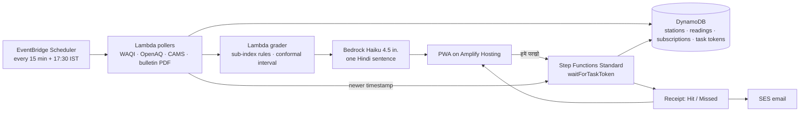

# Taaza Hawa · *अभी बाहर जाऊँ?* (Can I go outside right now?)

> **Track:** Air · **Event:** WeMakeDevs × AWS Environmental Hacks, Oct 8–11 2026 · **Mode:** solo, software-only, one device on camera
> **Status:** recommended by the round-4 council on Oct 4 2026 ([verdict](council/03-verdict.md)) at **6/10 winning potential**, conditional on the three-morning CPCB check ([T13](tickets/T13-kill-tests.md)). **No project code exists; the build starts when the clock starts on Oct 8.**
> **Inputs:** [winner playbook](../WINNER_PLAYBOOK.md) · research [R1](research/R1-delhi-ground-truth-oct-2026.md) [R2](research/R2-data-feeds-audit.md) [R3](research/R3-competitor-novelty-scan.md) [R4](research/R4-event-signals-and-precedents.md) [R5](research/R5-aws-capability-check.md) [R6](research/R6-science-evidence-pack.md) [R7](research/R7-citizen-friction-mining.md) [R8](research/R8-cpcb-source-staleness-check.md) · council [question](council/00-framed-question.md) [advisors](council/01-advisors-anonymized.md) [reviews](council/02-peer-reviews.md)

---

## 1. The problem in one paragraph

Every morning in October and November a Delhi resident decides whether to go outside: run, cycle, walk the dog, send the child to practice. The number they look at is a single AQI on a mirror app, with no age, no source and no error bar. Last season the loudest complaint on r/delhi was not "what is the AQI" but "can I trust it": the 7.4k-upvote post of a water sprinkler aimed at the Anand Vihar monitor, "my purifier says 500 indoors, the official says 150", "I can smell smog but the meter shows low" (R7). On Oct 4 2026 the mirror most people use showed Anand Vihar 31 hours old, and CPCB's own dashboard sits behind a captcha (R2, R8). CPCB's daily bulletin itself records that 2–3 of 46 Delhi stations do not report on an ordinary day, and 30 of 39 went silent during the Diwali 2025 peak (R1, R3). Nobody shows the person the *age* of the number they are about to act on, gives them a calibrated estimate when it is stale, and then grades that estimate in public when the real reading arrives.

### The 15-second pitch
*"It's 6:30 in Dwarka and I want to run. Taaza Hawa shows me one card: Go, Wait till 10, or Stay in, with the age of the reading it used. When the reading is stale it tells me the range to act as if, and when the station comes back it grades itself: Hit or Missed. Every Delhi station, every morning, on one scoreboard."*

---

## 2. What the research established and what it removed

| Claim | Status | Source |
|---|---|---|
| Delhi air is "poor" at 13 stations on Oct 4; forecast 207–215 for Oct 5–6; GRAP Stage I likely during Oct 5–11 | Verified | R1 |
| Hack-week air will be PM10-dominated (PM2.5 ~40–80, PM10 150–200); stubble share ~0–2 % | Verified | R6 |
| Mirror feeds (aqicn/WAQI, OpenAQ) lag CPCB by hours to ~1.5 days; CPCB's own dashboard is captcha-gated | Verified | R2, R8 |
| CPCB bulletin PDF (~17:00 IST) is reliable and states how many Delhi stations participated (43/46 on Oct 4) | Verified | R2, R8 |
| **Stations are "dark upstream" at CPCB this week** | **Not established.** "DTU dead since June" matches a mirror-wide freeze; NSIT Dwarka's mirror page no longer resolves | R8 |
| No live tool anywhere publishes station freshness or grades its own nowcasts | Verified absence | R3 |
| EPA inhalation rates: moderate → sedentary cuts dose ~5× | Verified | R6 |
| Nova 2 Sonic speaks Hindi, but not in Mumbai; Polly Kajal and Transcribe hi-IN work in Mumbai; Claude Haiku 4.5 has an India profile | Verified | R5 |
| SMS, Connect, WhatsApp to Indian phones are out for a new account; web push via own VAPID is the channel | Verified | R5 |

**Removed by the council:** the "would-have-been city AQI" (a model acting as judge), the email to DPCC (fake acknowledgement), the "dark station" accusation (unverified premise), any GRAP-threshold claim derived from an estimate, "pinned at 500" as evidence of anything (the index saturates at 500 by design).

---

## 3. The product

**Taaza Hawa** is a Hindi-first PWA with one card and one audit page.

### 3.1 The card (the 95 % state and the stale state are the same card)

| Element | Normal day | Stale day (nearest reading > 3 h old) |
|---|---|---|
| Question | **अभी बाहर जाऊँ?** | same |
| Answer (one of three) | **जाओ** · **10 बजे के बाद** · **अंदर रहो** | same, chosen from the interval's upper bound |
| The one sentence | "Dwarka Sector 8 station: PM10 sub-index 168, **40 minutes old**." | "Nearest reading is **31 hours old**. Act as if **210–260** (3 live neighbours, bias-corrected CAMS, last value). We will grade this when a fresh reading lands." |
| Button | none needed | **हमें परखो** ("Hold me to it") |
| Yesterday line | "कल: said 160–190, station read 174 → **सही**" | "कल: said 210–260, station read 288 → **चूक by 28**" |

Decision rule, deterministic and printed on the audit page: the answer is the CPCB AQI band of the governing pollutant's sub-index (PM10 in October, PM2.5 in winter), using the fresh reading if age ≤ 3 h, else the interval's upper bound. Band → answer mapping is fixed: Satisfactory/Moderate → जाओ; Poor → 10 बजे के बाद (the measured afternoon trough, R6); Very Poor or worse → अंदर रहो. Exercise multipliers from EPA EFH are shown as one explanatory line ("running breathes ~5× the air of sitting"), never as a health-outcome claim.

### 3.2 The estimate (the only model, and it is calibrated)

- Inputs: the station's last value, the three nearest live stations' current sub-index for the same pollutant, Open-Meteo CAMS for the cell, bias-corrected against that station's own last 30 days of matched hours.
- Output: a **conformal prediction interval** per station, calibrated on that station's OpenAQ history with real dropouts masked (split-conformal; target 80 % coverage). Hotspot stations (Dwarka, Anand Vihar, Mundka and the rest of the 13) get their own residual distributions because neighbour imputation runs low there (R6).
- The interval is shown as a range; the answer uses its upper bound. The interval never becomes a point "true AQI".

### 3.3 The judge and the loop

1. **Sense:** a 15-minute poller reads every Delhi station's value and timestamp from WAQI (and OpenAQ for history), CAMS from Open-Meteo, and the CPCB bulletin PDF at 17:30.
2. **Decide:** sub-index rules pick the band; staleness is the age of the reading at the named source.
3. **Act:** the user taps **हमें परखो**. A Step Functions execution opens and parks on `waitForTaskToken`; the token is stored in DynamoDB keyed by station and hour.
4. **Confirm:** when the poller sees a newer timestamp for that station, it reads the token and calls `SendTaskSuccess` with the returned value. The grader compares it with the interval: **सही** (Hit) if inside, **चूक by N** (Missed) if outside, **Missed, still waiting** at 72 h.
5. **Show:** the card's yesterday line, and the **scoreboard**: every Delhi station × every morning of the hack, Hit / Missed / Pending, with CPCB's own participation count quoted underneath ("CPCB bulletin: 43 of 46 Delhi stations participated").

The judge is the station's own next hourly value for the same pollutant. The bulletin's number is never used to grade an hourly estimate, because it is a 4 pm-to-4 pm mean (peer review 3).

### 3.4 What AI does

Claude Haiku 4.5 on the Mumbai `in.` profile turns a fixed template of numbers into one plain Hindi sentence. It never chooses the answer, the interval or the grade. If Bedrock is unavailable, a template sentence appears with a small "AI बंद" badge. If the Anthropic use-case form is not cleared by Oct 7, Bedrock is dropped entirely.

### 3.5 Coined concepts

- **Taaza badge:** the age of the number, always shown, always at a named source.
- **हमें परखो / Hold me to it:** the user's one tap that opens a graded promise.
- **The Scoreboard:** Hit / Missed / Pending for every station, every morning. The hero shot.

---

## 4. Honesty line

**May say:** reading age and the named source; the interval and its three inputs; Hit / Missed by N; CPCB's participation count, quoted verbatim; "station air, not your street".
**Must never say:** dark, offline, tampered, sprinkler, "true AQI is", "CPCB switched it off", "complaint received", any GRAP stage claim derived from an estimate, who is at fault for staleness, or any health outcome. Estimate, not truth. Gap, not accusation.

---

## 5. AWS architecture, one reason per service

| Need | Service | Why this, not the alternative |
|---|---|---|
| Polling cadence | **EventBridge Scheduler** | 15-minute and 17:30 IST schedules without a server; 14 M free invocations (R5) |
| Fetch, rules, grading | **Lambda** | Pure functions, unit-testable; pdfplumber parses the bulletin (no Textract: the table is text) |
| Ledger, subscriptions, task tokens | **DynamoDB** | Pay per request; the token must be persisted so the 17:30 or 15-minute poller can resolve it |
| The graded promise | **Step Functions Standard, `waitForTaskToken`** | A receipt is a waiting execution; judges watch it flip Running → Succeeded in the console; waits up to a year at no compute cost |
| The receipt by email | **SES** | Request production access before Oct 8; sandbox fallback to verified recipients |
| Live URL | **Amplify Hosting, static Vite PWA** | Free for 12 months; avoids the new-account CloudFront hold and App Runner's idle cost |
| One Hindi sentence | **Bedrock, Claude Haiku 4.5 `in.` profile** | Data stays in Mumbai/Hyderabad; words only, never decisions |
| Health | **CloudWatch** alarm on poller failures + `/health` JSON on the audit page | Degrade loudly: "feed age 4 h, last poll failed" in plain words |

Cost line for the write-up: under ₹100 for the hack at free-tier rates; the only paid calls are Bedrock sentences.

---

## 6. The three-minute solo film

| Time | On camera | Real / staged |
|---|---|---|
| 0:00–0:15 | Phone, 06:30, Dwarka, over-shoulder. "I want to run. This is the number everyone uses." Mirror app shows an AQI with an old timestamp. | Real |
| 0:15–0:45 | Taaza Hawa card: **अभी बाहर जाऊँ? → 10 बजे के बाद**. The sentence with the age and the range. Tap **हमें परखो**. | Real |
| 0:45–1:20 | Laptop: Step Functions execution Running on `waitForTaskToken`; DynamoDB item with the token; Lambda logs of the poller. One line: "the promise is parked until the station speaks." | Real console |
| 1:20–1:50 | Time-lapse caption. The poller sees a newer timestamp; execution flips to Succeeded; phone shows **सही** (or **चूक by N**). | Real; the caption is the only edit |
| 1:50–2:25 | **The Scoreboard**: every Delhi station × the four hack mornings, Hit / Missed / Pending; CPCB's participation line quoted. Architecture diagram, 10 seconds, one reason per service. | Real |
| 2:25–2:50 | "What fought back": the mirror lag, the captcha, the 24-hour mean that cannot grade an hourly guess. | Honest lesson |
| 2:50–3:00 | Tagline: *"The number has an age. Now it has a grade."* | |

**If no Delhi station is stale during Oct 8–11:** the card segment replays Oct 20–21 2025 from OpenAQ history under a burned-in **REPLAY: Diwali 2025 data** caption, and the Scoreboard shows live Hits on fresh stations to prove the grader runs.

---

## 7. Four-day build boundary

**Before Oct 8 (allowed: research, accounts, learning):** see [T11](tickets/T11-pre-clock-setup.md) and [T13](tickets/T13-kill-tests.md).

| Day | Build | Freeze line |
|---|---|---|
| **Thu Oct 8** | Repo at 08:00. WAQI + CAMS pollers → DynamoDB; sub-index rules; bulletin PDF fetch at 17:30 with pdfplumber; Lambda URL API; README with the architecture diagram. First commit by 10:00; commit every hour. | Thin loop on AWS by 20:00, ugly |
| **Fri Oct 9** | Vite PWA on Amplify: the card in Hindi first, Taaza badge, three answers; **हमें परखो** → Step Functions + token in DynamoDB; grader; SES receipt. Conformal intervals from OpenAQ history. Write the film script. | One graded receipt resolved on a real station |
| **Sat Oct 10 (DTU)** | Scoreboard page; CPCB participation line; Haiku Hindi sentence with "AI बंद" fallback; Amazon-team feedback; feature freeze 18:00; shoot B-roll at 06:30 and 17:30. | No new features after 18:00 |
| **Sun Oct 11** | Record (≤3:00, multiple takes), README "why each service", Builder Center blog ("the number has an age"), submit. Confirm the closing hour on the page first thing. | |

**Scope cuts, in order:** web push (own VAPID; four permission taps on cheap Android) → in-app card + SES only; the Bedrock sentence → template; multi-city; any map.

---

## 8. Kill tests and pivot rules (research only, before the clock)

| # | Test (Oct 5–7) | Pass | If it fails |
|---|---|---|---|
| K1 | Solve the CPCB captcha by hand at `airquality.cpcb.gov.in/ccr/#/caaqm-dashboard-all` each morning; screenshot Live / Delay / Inactive and per-station last-updated beside WAQI timestamps | Any of: CPCB and WAQI disagree (mirror lag is the user's problem), or 2–3 stations stale daily (stale branch is live) | If everything is fresh everywhere: the film uses REPLAY and the Scoreboard leads; the pitch becomes "every number has an age and a grade" |
| K2 | Pull Sept–Oct 2025 OpenAQ history for the Dwarka cluster; mask real dropouts; measure conformal interval coverage and width | ≥ 80 % coverage with width under one CPCB band on most days | Widen the honesty line ("range, not number") and lead with the Scoreboard; if width exceeds two bands, pivot to the labelled school-meet alternative (§9) |
| K3 | WAQI token: pull all Delhi stations with per-station timestamps | ≥ 25 stations | Watchdog has no teeth; fall back to OpenAQ + CAMS only, slower grading |
| K4 | Bedrock use-case form submitted; smoke-invoke Haiku `in.` profile; SES production requested; CDK bootstrap in ap-south-1 and us-east-1; empty Amplify app deployed | All green by Oct 7 | Drop Bedrock; stay in SES sandbox with verified recipients; document it |
| K5 | Read the 15-second pitch to someone outside Delhi; they say back what the app does | They mention "age" or "grade" | Rewrite the card copy until they do |

---

## 9. Alternatives the council rejected, and the one to keep warm

| Idea | Why rejected | Keep warm? |
|---|---|---|
| **Hawa Hold for October school meets** (DSSG compressed into October by HC order; CAQM Nov–Dec sports ban; no Indian tool exists, R3 #1 on novelty × realism) | Needs the entrant to role-play a coach whose judgement is the product; verification is station air, not children | **Yes.** If K2 fails, revive with a burned-in "SIMULATED SCHOOL" label and the same engine: this is the scaling slide for Taaza Hawa in any case ("a school's PE period is the same card, for 40 children") |
| Hotspot Local Excess dispatcher | DPCC opened an AI command centre on Oct 2 2026; sprinkling has never shown a PM2.5 drop at a Delhi monitor, so the receipt would mostly read "Missed" | No |
| Dark Monitor / watchdog with counterfactual city AQI | Premise not established (R8); counterfactual is a model acting as judge; accusatory | Only as the quoted CPCB participation line |
| "Where do I report at 1 am" complaint router | Green Delhi app already routes; verifier is MCD | No |
| GRAP for me | grapstatus.com exists; verdict with little action | No |
| Breath Ledger (phone-motion dose) | EPA TracMyAir exists; "fitness app" | Folded into the one explanatory multiplier line |
| Net-meter clock for solar applicants | No applicant, no feed | No |

---

## 10. What a judge should remember

One card, one tap, one grade. The number has an age. The app grades itself every morning against the station it borrowed from, and the Scoreboard shows every miss as loudly as every hit. No sensor, no second actor, no accusation.
